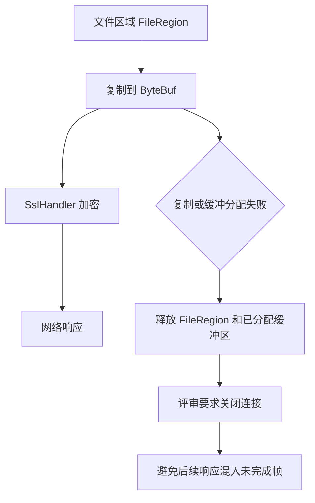
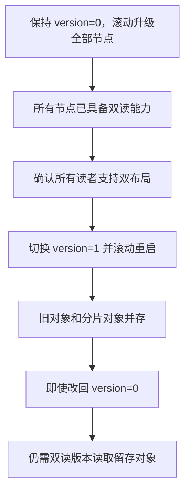

[← 流存储技术观察](https://bryantchang1992.github.io/ai_memory_chang_ai_team/stream-storage-observer/)

观察窗口：2026 年 10 月 9 日 19:57 至 10 月 16 日 19:57（北京时间，UTC+8），即 10 月 9 日 11:57 至 10 月 16 日 11:57 UTC。窗口固定在本次调研启动时，正文事件时间统一使用 UTC；窗口外的材料仅用于解释背景或校正上期。

[上一期](https://bryantchang1992.github.io/ai_memory_chang_ai_team/stream-storage-observer/2026-10-09/)主要追踪分配、重试与恢复的边界。本周更值得注意的是，优化逐渐从算法或基础组件推进到真实运行路径，失败后的下一步和版本之间的共存方式开始成为评审焦点。

Kafka 的后台分配仍在讨论失败后由谁重新驱动，uniform2 则先把数据结构和配额算法分步合并；Fluss 开始将 TLS、证书身份以及 Kafka Produce 接入具体协议路径；AutoMQ 已将多桶 RouterChannel 合并，随后用逐桶客户端、WAL 前缀分片和并行整理扩展对象存储路径。这些进度不能用一个“已支持”概括：本文区分 proposed（提议或评审中）、accepted（提案或发行投票通过）、merged（代码合并至所列分支）与 released（正式发行），也区分作者测试报告和独立测量。

| 核心线索 | 本周实质变化 | 截止阶段 |
|---|---|---|
| Kafka 后台分配与 uniform2 | 失败恢复评审继续；索引与配额前两步合并 | 后台分配与完整 uniform2 仍 open |
| Kafka 文件读失败 | TLS 旧缓冲重发问题提出修复；磁盘复读按 log directory 限并发 | 均为待合并 PR |
| Fluss TLS | 服务端运行接线与证书 principal 映射进入评审 | FIP accepted，端到端实现未交付 |
| Fluss Kafka Produce | FIP 投票；传输框架合并 | 完整 Produce 链路仍 open |
| Fluss KV 存储 | RocksDB 升级、快照兼容修复与共享 HCC 合并 | main 已合并，未确认新正式版 |
| AutoMQ 对象存储路径 | 多桶、CRT、WAL 分片、并行整理等集成至多条分支 | 代码已合并并进入 nightly，未确认新正式版 |

具体日期、分支与原始证据随下文论断列出。状态表只表示所列部分的成熟度，不代表整个功能已完成。
## Kafka：性能优化必须给失败留出恢复路径

### 后台分配：防住旧 epoch 之后，还要有人重新驱动

[PR #23688](https://github.com/apache/kafka/pull/23688) 继续尝试将 consumer assignor 移到 coordinator 后台线程。它拟默认开启 offload，触发重分配的 heartbeat 不一定立即得到新 assignment，结果由后续 heartbeat 获取。计算移出前台可以降低请求阻塞，却也改变失败传播：同步计算失败时，请求失败自然促使客户端重试；后台计算失败时，最初的请求可能已经成功返回。

上期讨论的是 epoch 回滚：触发计算的日志写入失败，group epoch 回到旧值，但已经启动的计算不会随之回滚；下一次递增可能复用同一数字。**10 月 11 日的 [4e0c273 提交](https://github.com/apache/kafka/commit/4e0c2739158540e32289a2ad942c27cf04f350b1)**补强 in-flight epoch 防护。“取消”仍不会中断已执行的计算，新旧任务可能重叠，结果能否安装、旧任务清理会不会误删新状态，必须分别验证。

**10 月 13 日 10:20:24 的评审**又给出了一个活性反例：consumer group 的成员如果全部使用 classic 协议，异步 assignor 抛异常、target assignment 写入失败，或者 coordinator 在结果持久化前切换，都可能让该组停在 Assigning。原因是 classic heartbeat 和 sync 路径不调用 maybeUpdateTargetAssignment；旧 assignment epoch 又未推进，无法触发要求成员 rejoin 的条件。于是结果丢失后，没有确定的后续请求重新驱动计算，只能等待成员重新加入。这里是 consumer group 内的 classic 协议兼容路径，不能泛化为所有 classic group 的已知生产故障。[完整反例与测试](https://github.com/apache/kafka/pull/23688#discussion_r4257435641)

同轮评审还发现测试替身会执行已经取消或被替换的任务，与正式 executor 行为不同。这样的测试即便通过，也可能证明了错误的执行路径；应先让 mock 跳过失效任务，再验证只有替代任务能安装 assignment。[取消测试评审](https://github.com/apache/kafka/pull/23688#discussion_r4257435830)

这一周使评审重点从“旧结果会不会写入”扩展到“新结果迟迟不来时谁负责恢复”。排队、计算、安装的耗时需要分开观测；异步失败也不能只藏在一个日志中。等元数据提交后再真正调度 executor 的思路仍是后续建议，尚不能写成已实现的保证。[可观测性讨论](https://github.com/apache/kafka/pull/23688#discussion_r4256827407) · [提交感知调度建议](https://github.com/apache/kafka/pull/23688#discussion_r4256998917)

截止时 #23688 仍 open、未 merged，上述失败路径未见后续解决回复。因此本期记录的是待评审设计的新边界，而不是宣称主干已经统一修复了这类问题。

### uniform2 分步合入：逐 topic 公平有清楚的适用边界

旧 uniform 主要看成员获得的分区总数，某个热点 topic 仍可能集中到少数成员。uniform2 优先让每个 topic 在订阅者之间均分：先为每人确定整数配额，再分配余数，在约束允许时保留原 ownership，最后改善总量平衡。这里的“负载”仍是分区数量，并不根据实际消息字节率动态调度。[完整 assignor PR #23723](https://github.com/apache/kafka/pull/23723)

本周代码开始分步进入 trunk。**10 月 13 日合并的 [#23732](https://github.com/apache/kafka/pull/23732)**构建 IndexedGroup 与 CurrentAssignment：按 member/topic ID 建立确定性索引，将订阅相同的成员组成 cohort，过滤已删除 topic 和失效 ownership。**10 月 15 日合并的 [#23733](https://github.com/apache/kafka/pull/23733)**增加 Quotas 和前两步：先尽量保留已有 extra partitions，再把剩余 extra 分给当前较轻、尚未得到该 topic extra 的订阅者；订阅者较少的 topic 优先，同 cohort 内轮转。对象不可变边界和步骤包结构的整理也已分别通过 [#23801](https://github.com/apache/kafka/pull/23801)、[#23823](https://github.com/apache/kafka/pull/23823) 合并。

但逐 topic 公平并不保证每个成员总数相等。**10 月 11 日的评审**给出很直观的例子：成员 0 订阅十个 topic，其余十个成员各只订阅其中一个；每个 topic 有十个分区。若每个 topic 的两个订阅者各分五个，成员 0 最终得到五十个，其余成员各五个。作者在 10 月 12 日接受这一反例，同时指出额外的 balance 步骤对其他订阅拓扑仍有帮助。[评审例子](https://github.com/apache/kafka/pull/23732#pullrequestreview-5481155666) · [作者回应](https://github.com/apache/kafka/pull/23732#issuecomment-6126185426)

仍 open 的 [#23735](https://github.com/apache/kafka/pull/23735) 只在接收者订阅该 topic、尚无该 topic 的 extra、且总分区数至少少二时迁移，以单调降低分配规模平方和来保证终止。随后 [#23736](https://github.com/apache/kafka/pull/23736) 才按最终 quota 放置具体 partition；“移动最少”也是相对于固定 quota 而言。这些约束解释了它能改善什么，也解释了为何不能承诺任意异构订阅下的全局最优。

此外，[#23734](https://github.com/apache/kafka/pull/23734) 在 10 月 14 日是 **closed、未合并**：balance 已能自行寻找移动，不再需要独立 ExtraPartitionMoves 抽象。关闭一张 PR 不等于增加一项已交付功能。[关闭原因](https://github.com/apache/kafka/pull/23734#issuecomment-6167299174) 截止时完整 #23723、balance 和 placement 均仍 open，uniform2 尚未注册为内置 assignor，rack awareness 也留给后续，不能当作已经可启用的新默认算法。

### Fetch 文件读错：TLS 错误传播与坏盘隔离需要联动

FileRecords 真正读取 segment 的动作可能发生在网络发送阶段，已经离开 LocalLog.read 的异常处理范围。此时客户端断连和介质读取错误都可能表现为 IOException；若网络层一律按断连处理，坏日志目录可能继续在线。[#23445](https://github.com/apache/kafka/pull/23445) 因此提议让 FileRecords 记录失败字节区间，原异常继续抛向网络层，再由存储层后台重读；只有重读也出现适用的 IOException，才通过 LogDirFailureChannel 将目录 offline。EOF、无进展或并发文件关闭本身都不足以证明坏盘，瞬时错误在重读时消失也仍难确认。

本周评审进一步约束探测成本。**10 月 14 日**要求把重读移出网络线程，避免普通消费者断连拖住同 processor 的其他连接；**10 月 15 日**又指出按 segment 限流不够，一块慢坏盘可能有许多分区，同时占满共享后台 scheduler，影响健康目录的清理和 checkpoint。**10 月 16 日 01:28:56**作者确认改为每个 log directory 同时最多一个探测，跨分区共享 admission 状态。[移出网络线程](https://github.com/apache/kafka/pull/23445#discussion_r4277313358) · [按目录限流理由](https://github.com/apache/kafka/pull/23445#discussion_r4289136322) · [作者落实回复](https://github.com/apache/kafka/pull/23445#discussion_r4289968210)

**10 月 15 日新开的 [#23832](https://github.com/apache/kafka/pull/23832)**揭示了 TLS 发送路径的另一层问题。SslTransportLayer.transferFrom 在读下一块前 clear 缓冲区；若读取失败或没有新字节，又没有正确 flip，上一块内容可能仍显得可发送。同次 transfer 已部分成功时，异常还可能被吞掉，下一次调用将旧块当成新位置的数据发送，消费者就收到损坏 batch。问题在于陈旧缓冲区字节被重复发送，不能据此说 TLS 加密算法损坏了数据，也不能说磁盘原始记录已被改写。

修复是在 finally 中 flip，确保缓冲区只暴露本次真正读到的字节；失败时为空，下一轮重新读并使原始读错可见。它和 #23445 的分工非常重要：一个阻止用旧字节掩盖错误，另一个进一步识别存储故障并隔离目录。仅修 TLS 并不会自动让坏盘离线。

作者报告了一组受控故障注入：Linux 6.8、Docker 内一个 controller 和三个 brokers，以 dm-dust 制造 leader segment 尾部不可读。基线 TLS 出现 corrupt batch；只加 #23832 后不再发坏 batch，但目录仍在线、Fetch 继续失败；组合两项补丁后目录 offline、leader 转移，并读完两万条测试记录。**这是作者特定环境下的正确性测试，本期没有独立复验，也不是性能基准。**[条件与对照结果](https://github.com/apache/kafka/pull/23832#issuecomment-6199313266)

截止时两项 PR 都未合并。#23445 还不覆盖走 UnalignedFileRecords 的 KRaft snapshot 发送路径；唯一日志目录或 metadata 目录出错时，既有故障规则仍可能使节点停机。值得关注的是异常传播、故障判断和后台资源隔离开始形成完整链路，不能提前写成已发布的无感恢复能力。

### 已合并的恢复修复，不能追溯算进旧候选包

**10 月 15 日 20:37:15 合入 trunk 的 [Streams #23791](https://github.com/apache/kafka/pull/23791)**修复了另一条恢复链：事务提交超时后，abort 再抛异常，RecordCollector 未完成清理，旧 changelog offsets 留存；清空的 store 还在恢复时若任务再次 clean close，旧高 offset 可能写入 checkpoint，下次恢复便跳过缺失记录。

最终代码是在 finally 中直接清 offsets、重置 sendException；调用侧 TaskManager 则以带异常的 WARN 记录 dirty-close 失败。并非旧描述中笼统地在 finally 再调用 close()，后者还可能让 pending send exception 覆盖原始 abort exception。[关键评审](https://github.com/apache/kafka/pull/23791#discussion_r4256402861) 修复已回移 [4.4 分支](https://github.com/apache/kafka/commit/614efd6e0f14f59076468a13d5dbab09038ca2ad) 和 [4.3 分支](https://github.com/apache/kafka/commit/05f0edf48ead2bf05141d100af2ae914ef9bb91a)，但这仍不足以确认某个已发布二进制包含它。

版本时间线提供了具体例子：**10 月 13 日 08:32:54，Kafka 4.4.0 RC4 已正式通过投票**，收票邮件说将继续准备公告和文档。[投票结果](https://www.mail-archive.com/dev@kafka.apache.org/msg159052.html) 截止时站点 [Add 4.4 release #925](https://github.com/apache/kafka-site/pull/925) 仍 open，本次未核实正式发布公告；应称 RC4 投票通过。4.4 分支同日 14:11:42 已改成 [4.4.1-SNAPSHOT](https://github.com/apache/kafka/commit/0c9e86ecfa053098a1de1776ff318bfaf85c0d85)，故 10 月 15 日回移的修复也不能倒算进此前投票的 4.4.0 RC4。

### 上期更正与持续跟踪

**更正：上期仍将 KIP-1349 概括为字节阈值快照；作者实际已在 10 月 8 日 06:25:54 UTC 表示将改回计数方案。**原因是共享状态日志的裁剪仍受最慢 share partition 快照限制，单组字节阈值无法直接给出物理保留日志量的上界。这封邮件早于本期窗口和上期截点，应作为上期遗漏的更正，不能算本周新增。邮件表达的是将修改方案，不足以证明页面已改完或投票通过。[作者原邮件](https://www.mail-archive.com/dev@kafka.apache.org/msg158966.html)

上期的 cold snapshot [#23750](https://github.com/apache/kafka/pull/23750) 仍 open，本次未见窗口内新提交或讨论；rack-aware opt-in [KIP-1379](https://cwiki.apache.org/confluence/spaces/KAFKA/pages/451979127/KIP-1379+Make+server-side+rack-aware+assignment+opt-in) 仍 Under Discussion，未发现新决议或实现合并。对象整理 [KIP-1165](https://cwiki.apache.org/confluence/spaces/KAFKA/pages/350783996/KIP-1165+Object+Consolidation+for+Diskless) 也仍处于重新开启的讨论，不能重发为本周落地。

Diskless 确有一条新澄清：**10 月 9 日 23:56:22**，Greg Harris 表示更新了 [KIP-1163](https://cwiki.apache.org/confluence/spaces/KAFKA/pages/350783976/KIP-1163+Diskless+Core) 的 ISR/迁移说明。pure Diskless 的本地副本是缓存，空 ISR 可以健康；仍保留 classic 数据区间的 Hybrid，则要遵守对应持久性要求。**10 月 15 日的 v25 草案**进一步说明：调整 leader epoch 时，与 StorageEngines 状态变更原子地封印 classic 日志并隔离旧 leader；Diskless Coordinator 等 classic replication 完全追平，再接收 Produce。这让迁移交接的顺序更明确，但仍是讨论期设计，并不证明实现、事务和幂等细节已全部解决。[v25 版本记录](https://cwiki.apache.org/confluence/rest/experimental/content/350783976/version/25)[Apache 原邮件](https://lists.apache.org/thread/x109d78nlg56stgfhw9o2b26tp89q57y)
## Fluss：运行时接线开始推进，兼容性要落实到字节与状态

### TLS 服务端进入评审，失败连接与内部通信仍是门槛

上期的 #3813 合并了 SSL 配置和 context 工厂，本周 **10 月 14 日新建的 [#4644](https://github.com/apache/fluss/pull/4644)** 才把这些组件接入真实服务端连接：启动时校验 listener 和证书，在帧解析、认证之前插入 SslHandler，使既有协议栈接收解密后的字节。[FIP-29](https://cwiki.apache.org/confluence/spaces/FLUSS/pages/406620533/FIP-29+m+TLS+Support) 已 accepted，但这个运行时 PR 仍 open，二者应分开记录。

最直接的代价出现在日志读取。原有 FileRegion 零拷贝文件发送不能直接交给只接受 ByteBuf 的 SslHandler，补丁引入 TlsFileRegionHandler，先将文件复制到内存，再经过加密路径。因此 TLS listener 要放弃原先的 sendfile 零拷贝能力。这里有明确的数据路径成本，但尚无端到端性能数字，不能自行给出吞吐损失比例。[服务端实现与测试说明](https://github.com/apache/fluss/pull/4644)

**10 月 15 日 15:05:14 的评审**进一步指出：retention 或 truncation 可能在复制期间关闭文件。若响应头已经发送，正文只发了一半，单纯让 write promise 失败、却继续复用连接，后续响应可能被客户端当成当前帧剩余字节。评审要求失败时关闭连接，并将 direct-memory 分配失败纳入资源清理。这说明安全接线必须同时维护原有协议的帧边界，不能只验证握手成功。[失败语义评审](https://github.com/apache/fluss/pull/4644#discussion_r4284691546)

**图 1：TLS 文件读取为何需要同时处理复制与连接失败**

图示根据 #4644 及 10 月 15 日评审抽象，仅表示待评审方案和要求；并非已发布行为，也省略了具体 Netty promise 传播。服务端已有实际 cipher 协商、TLS/plaintext 双 listener 和文件加密测试；客户端及服务端出站接线 [#3797](https://github.com/apache/fluss/issues/3797) 仍未完成，作者明确说明此时给 internal listener 开启 TLS 会破坏服务器之间的请求。评审因此追问是否应直接拒绝这种配置，而不是到运行时才失败。[internal listener 评审](https://github.com/apache/fluss/pull/4644#discussion_r4284723825)

并行的 [#4641](https://github.com/apache/fluss/pull/4641) 将证书 DN 映射为稳定 principal，避免大小写、转义和格式差异影响 ACL 与 super.users。它在 10 月 15 日获得 APPROVED review，截止时仍未合并，且没有 runtime 接线；mTLS 认证插件 [#3793](https://github.com/apache/fluss/issues/3793) 也仍 open。评审还要求不要把完整服务端 mapping rules 暴露在客户端认证错误中。[信息暴露边界](https://github.com/apache/fluss/pull/4641#discussion_r4284574249)

本周阶段应概括为：基础已 merged，服务端接线和身份映射在评审，客户端与 mTLS 尚待补齐。距离端到端可用还需要出站连接、失败关闭和集群内通信验证，不能写成生产集群 TLS 已交付。

### Kafka Basic Produce：先明确 schema-first 写入契约，再逐层接通

本周 [FIP-55](https://cwiki.apache.org/confluence/spaces/FLUSS/pages/449286957/FIP-55+Kafka+Protocols+Compatibility+-+Basic+Produce) 的讨论继续收敛。它让 Kafka producer 成为 Fluss 原生表的写入口：Produce 中完成 payload 到 typed row/Arrow 的转换，最终写入 Fluss 日志，读取仍依赖 Fluss 客户端或计算引擎。这避免保存原始 Kafka 日志再异步物化一份表，但转换错误必须在写入时返回；Fluss DDL 的 schema 是权威，不能把未来重新解释原始字节当作兜底机制。

**10 月 10 日及 12 日的作者回复**确认跨数据库 topic 映射、显式 table.kafka.enabled、固定可选系统列和 table.kafka.* 属性等约定；默认数据库改为 fluss，rescue 也使用固定列。database.table 可以定位跨库表，裸表名别名依赖默认库；表不会因为碰巧是 Arrow log table 就自动暴露成 Kafka topic。[10 月 10 日回复](https://www.mail-archive.com/dev@fluss.apache.org/msg01496.html) · [10 月 12 日回复](https://www.mail-archive.com/dev@fluss.apache.org/msg01514.html)

这份兼容合同包含真实取舍。用户显式声明 _kafka_key、_kafka_headers、_kafka_metadata、_kafka_rescue，系统不会自动增加未声明列；headers 用 MAP 表达，重复键保留最后一项，放弃原始顺序及重复项以利于表查询。rescue 可以容纳未知字段和名称冲突，却不掩盖已知字段类型错误或 NOT NULL 失败。因此它面向 schema-first ingestion，并不承诺 Kafka record 无损往返。Kafka Fetch、自动 schema 推断、Schema Registry、事务和幂等 Produce 都不在首期范围。[FIP-55 范围与列语义](https://cwiki.apache.org/confluence/spaces/FLUSS/pages/449286957/FIP-55+Kafka+Protocols+Compatibility+-+Basic+Produce)

**10 月 13 日 03:02:29 UTC 启动的投票**明确只覆盖非幂等 Produce。归档网页按 -0700 显示为 10 月 12 日，本文按 UTC 换算。截至窗口结束，取得的邮件只有投票和后续赞成意见，未核实 RESULT，应保留为投票中，不能替社区宣布 accepted。[投票原文](https://www.mail-archive.com/dev@fluss.apache.org/msg01516.html)

实现上，**10 月 14 日 05:35:38 合并的 [#4259](https://github.com/apache/fluss/pull/4259)** 增加 typed handlers、冻结的能力注册表、异步 dispatch、错误映射和 buffer 生命周期测试。它仍保留原生产 request handler，新 dispatcher 的生产接线也留给后续工作，尚无具体 Produce handler。后面的能力协商 [#4260](https://github.com/apache/fluss/pull/4260)、DDL 映射 [#4277](https://github.com/apache/fluss/pull/4277)、Metadata [#4261](https://github.com/apache/fluss/pull/4261)，以及 Produce 语义 [#4284](https://github.com/apache/fluss/pull/4284)、转换 [#4285](https://github.com/apache/fluss/pull/4285)、原生 append [#4286](https://github.com/apache/fluss/pull/4286) 均仍 open。

这些分层 PR 在 9 月就已创建，本周发生的是提交、讨论和底层框架合并。例如 #4286 在 10 月 16 日 09:30:26 仍有 [null value 与 native offset 相关提交](https://github.com/apache/fluss/commit/af1ec7e52bfd4d6673ab16338f9452952921c8b3)，不能把整个系列说成当周新提案。分层的理由也很清楚：协议层管理版本、acks 和 partition 错误；转换层处理 typed row；append 层必须继承 Fluss 原生的 leader、offset 和复制确认，不能让 Kafka 的类型侵入存储内核。

目前请求数限流还未等同 retained-payload 字节预算；作者尚未运行全仓库测试、Flink SQL 运行验证、吞吐和内存压力测试，已报告的测试也对应正文注明的较早提交。FIP 与部分 PR 的 _kafka_metadata 字段描述也存在迭代差异，本期不把中间示例整理成可直接使用的配置教程。准确的进度是“兼容语义逐步明确，传输框架已合并”，完整 Kafka 写入入口仍在开发。[#4286 的验证范围与限制](https://github.com/apache/fluss/pull/4286) · [总跟踪项 #4185](https://github.com/apache/fluss/issues/4185)

### RocksDB 升级：同一个 format_version 仍可能写出旧 reader 不认识的特征

**10 月 10 日 12:30:18 合并的 [#4133](https://github.com/apache/fluss/pull/4133)**，将 FRocksDB 6.20.3 系列迁移至 Fluss 维护的 fluss-rocksdbjni 11.8.1-fluss-3，并适配 JNI/API、TTL compaction filter 和新版本可能生成的空 checkpoint 文件。服务端写出的 KV snapshot 还会被旧客户端读取，因此升级的兼容责任横跨 server 和 reader，不能只看新服务端能否启动。

第二天合并的 [#4598](https://github.com/apache/fluss/pull/4598) 就补上一处具体边界。虽然此前已固定 format_version=5 和 CRC32c，新 RocksJava 的 uniformCvThreshold 默认值仍会在均匀索引键中写入 is_uniform 标志。旧 FRocksDB 将该 bit 当成 restart count 的一部分，扫描顺序整数主键时可能报 bad block contents。修复显式把 threshold 设为 -1，用一万条连续 long key 验证新服务端快照能被旧 reader 全量扫描；旧的两条 key 测试触发不了这一条件。

这里可复用的经验是：文件总体版本相同，不代表新库每个默认优化都与旧 reader 兼容。混版本测试必须让 SST 真正生成相应的索引和过滤器特征，否则小样本“能打开文件”给出的安全感可能不足。

**10 月 12 日 14:13:12 合并的 [#4611](https://github.com/apache/fluss/pull/4611)** 随后将 TabletServer 共享 block cache 从 LRU 换成 AutoHyperClockCache，目标是降低并发缓存元数据争用。容量、指标和所有权保持原样；独立 per-DB cache 与 WriteBufferManager accounting cache 仍使用 LRU。PR 明确没有工作负载级性能对比，不能给出 HCC 吞吐、P99 或命中率收益。进一步启用 partitioned index/filter、扩展 per-DB HCC 的 [#4612](https://github.com/apache/fluss/pull/4612) 仍 open，开关默认关闭，关闭也不会重写已存在的 SST。

RocksDB 升级作者确实提供了三轮交替顺序的普通 KV 对照：Mac mini M4、16 GB、单台 OrbStack arm64 VM 内运行一个 coordinator 和三个 TabletServer，四类吞吐变化约在 -1.1% 到 +1.6% 之间，作者判断大体持平。这是小规模配置下未见明显回归的有限证据，不能外推生产，也不能归因于两天后才合并的 HCC。[完整实验配置与数据](https://github.com/apache/fluss/pull/4133#issuecomment-6097504055)

### 恢复和其他跟踪：明确哪些边界仍未解决

全盘丢失恢复 [#4567](https://github.com/apache/fluss/pull/4567) 仍未合并，但本周并非没有变化。**10 月 12 日的评审**撤回了此前一项容错建议：若远端文件物理终点是 150、逻辑有效终点是 120，leader 从 120 恢复续写，而 follower 仍按旧文件和旧 writer snapshot 跳到 150；若 leader 已续写超过 150，follower 就可能跳过新写的 120–150，却看似已经追平。**10 月 14 日的 [41bcb3d 提交](https://github.com/apache/fluss/commit/41bcb3deb5b9f5ec5086b3b35259d2797895399e)**恢复对 clipped remote tail 的拒绝并补测试。此处数字来自评审的说明案例，不是性能测量。[完整评审](https://github.com/apache/fluss/pull/4567#pullrequestreview-5488623266)

新问题 [#4600](https://github.com/apache/fluss/issues/4600) 则关注部分丢盘：若 ISR 中丢失本地数据的空副本被选为 leader，仍保留较长本地 WAL 的 follower 可能被迫截断原本可恢复的数据。优先选择最佳本地副本尚未实现。上期区分的“恢复一致 KV”“保住全部已确认写入”“保留连续 changelog”仍是三项不同保证，远端恢复补丁并未把它们合并为零丢失承诺。

另外几项短更新可以直接与上期对账：

- 表内均衡 [#3917](https://github.com/apache/fluss/pull/3917) 于 10 月 12 日合并，先转 leadership、必要时迁副本；rack-aware 摆放不承诺每台服务器拥有严格相等的 leader 数。[10 月 10 日保证边界说明](https://github.com/apache/fluss/pull/3917#discussion_r4236919276)
- ARRAY last_n [#4570](https://github.com/apache/fluss/pull/4570) 同日合并，每次更新仍重写数组，FULL changelog 保留前后镜像，适合较小 N；讨论中的二进制 splice 加速是另一个未合并原型，不能计为本次收益。
- C++ 非阻塞 lookup [#4559](https://github.com/apache/fluss/pull/4559) 仍 open，10 月 14 日新评审建议用 request_id+Poll 批量收结果，避免逐 handle Wait 再次被慢请求挡住；目前只是 API 讨论。Rust 故障隔离 [#4563](https://github.com/apache/fluss/pull/4563) 未见窗口内实质新增。[C++ 评审原文](https://github.com/apache/fluss/pull/4559#issuecomment-6159867478)
- Iceberg 的模块拆分 [#4646](https://github.com/apache/fluss/pull/4646) 与版本化 JSON 状态 [#4660](https://github.com/apache/fluss/pull/4660) 已合并；真正的 [1.12 插件 #4671](https://github.com/apache/fluss/pull/4671) 在 10 月 16 日 11:49:30、距离截点约七分半时才新建，仍 open。评审验证了 1.10 savepoint 向 1.12 升级，反向失败，不能称为双向自由切换。[方向性验证](https://github.com/apache/fluss/pull/4660#issuecomment-6208743062)

消费位点 [FIP-53](https://cwiki.apache.org/confluence/spaces/FLUSS/pages/449282458/FIP-53+Log+Scanner+Offset+Management) 也于本周启动投票，首期收窄为手动分配消费者的持久化 offset，成员管理和 rebalance 留待后续；截至截点未核实投票结果。这是值得继续研究的新线索，不应提前描述为完整 consumer group 已实现。[10 月 12 日投票](https://www.mail-archive.com/dev@fluss.apache.org/msg01506.html)

Fluss 本窗口未发现新正式 release；以上 merged 项只代表进入 main。最近的 [v1.0.0 GitHub 发布记录](https://github.com/apache/fluss/releases/tag/v1.0.0) 在 9 月，属于背景。
## AutoMQ：疏散对象存储压力，也显式承担格式兼容

### 多桶 RouterChannel 合并：真正的增量在重入与关闭竞态

上期刚出现的 [#3642](https://github.com/AutoMQ/automq/pull/3642)，于 **10 月 10 日 09:59:20 合入 1.7**。原先配置虽然能列出多个 bucket，默认 provider 却只打开第一个；新实现统一攒 batch，将整批交给可写桶。它从两个随机候选桶中比较在途请求数，而不是遍历全部桶寻找全局最小值；只读桶继续服务旧 offset，offset 中的 bucket ID 决定读取位置。相同 order hint 的 future 仍按队列顺序兑现，epoch 清理也要等相关 append 完成。跨桶并行没有取消这些顺序约束。[合并后的 MultiBucketsRouterChannel](https://github.com/AutoMQ/automq/blob/fb8879af4470b0028f3b3eb14d24f12d499291fb/core/src/main/java/kafka/automq/zerozone/MultiBucketsRouterChannel.java)

本周最有价值的变化来自评审对资源所有权的修补。**10 月 9 日 11:57:49**，作者确认把 ordered future 的完成移到 readLock 之外：CompletableFuture 的下游 callback 可以同步重入 append、nextEpoch、trim 或 close；如果持有读锁完成 future，而 callback 再请求写锁，就可能自锁。epoch bookkeeping 仍在锁内，完成队列继续负责可见顺序，另补 callback 推进 epoch 的回归测试。这条回复发生在本期起点后 49 秒，是对上期初稿的真实增量。[修正回复](https://github.com/AutoMQ/automq/pull/3642#discussion_r4229840232)

第二处发生在 **10 月 10 日**。评审指出，callback 先检查未关闭，close 随后清空缓存，callback 再把 ByteBuf 插回缓存，会留下无人触发淘汰的直接内存。修正将“检查 closed 与移交缓存所有权”纳入 readLock，与 close 的 writeLock 互斥：要么先放入后统一清理，要么观察到关闭并释放。由此可见，多桶的主要工程负担不只是选桶，而是并行完成后谁负责释放数据，以及清理动作是否仍有唯一、完整的边界。[评审问题](https://github.com/AutoMQ/automq/pull/3642#discussion_r4237188700) · [作者修复回复](https://github.com/AutoMQ/automq/pull/3642#discussion_r4237210218)

### WAL 前缀分片：256 是布局常量，双读也不等于任意回滚

跨桶之外，[#3657](https://github.com/AutoMQ/automq/pull/3657) 继续疏散单个桶内部的 key prefix 压力，**10 月 15 日 08:07:21 合入 1.7**。传统 Object WAL 和 ZeroZone RouterChannel WAL 原先按 broker/epoch 聚集对象；新布局在 epoch 前插入 s00 至 sff，以 `(objectStartOffset / 64 MiB) % 256` 决定 shard。记录 offset、对象内容和 router 协议不变，变的是对象路径。256 是固定分片数，不能当作吞吐提升倍数。[最终 ObjectUtils 代码](https://github.com/AutoMQ/automq/blob/435f240744cb29c3eb9712ecc157d799e4094ba2/s3stream/src/main/java/com/automq/stream/s3/wal/impl/object/ObjectUtils.java)

这一 PR 的评审过程值得完整读到结尾。中间版本曾加入 AutoMQVersion capability gate，10 月 14 日维护者又建议不要为 1.7 增加 feature level，而改用 WAL bucket URI 的 version 参数。那条建议还提过 64 shards；**10 月 14 日 21:48:58 的最终回复和合并代码明确采用 256 shards，删除 feature gate、startup gate 和 downgrade restriction**。不能把中间讨论的保护措施拼接到最终方案里。[维护者调整建议](https://github.com/AutoMQ/automq/pull/3657#issuecomment-6163066799) · [最终设计与验证说明](https://github.com/AutoMQ/automq/pull/3657#issuecomment-6179241504)

最终契约如下：

| WAL URI 设置 | 新写布局 | 读取已有对象 |
|---|---|---|
| version=0，默认 | 旧路径 | 先旧布局，缺对象时再找分片布局 |
| version=1 | 256 分片路径 | 先分片布局，缺对象时再找旧布局 |

权限、网络等错误不会被当成“对象不存在”而静默回退；恢复与 trim 保留对象原始完整路径，无需迁移旧对象。升级必须先让全部节点具有双读能力，仍使用 version=0，再切换 version=1 并滚动重启。写出分片对象后，二进制只能回退到仍懂双布局的版本；改回 version=0 只影响以后写入，不会重写已经留存的分片 WAL。[配置中的升级约束](https://github.com/AutoMQ/automq/blob/435f240744cb29c3eb9712ecc157d799e4094ba2/core/src/main/java/kafka/automq/AutoMQConfig.java)

**图 2：WAL 布局的两阶段切换与回滚边界**

图示依据 #3657 最终回复整理，省略具体部署顺序和错误处理；它说明兼容条件，不承诺自动阻止错误升级。移除 feature gate 降低了旧分支的协议管理成本，也把防止过早启用新格式的责任交给运维。迁移期 preferred path 缺失还可能多一次查找，这是机制推论，目前没有量化数据。

作者报告通过双布局、恢复、故障转移、trim/deletion 和 shard wraparound 等测试，同时明确没有 live S3 请求率或 SlowDown 基准。应把“路径布局与兼容测试已合并”和“生产限流已改善”分开。目前能确认前者，后者仍待公开测量。[最终测试说明](https://github.com/AutoMQ/automq/pull/3657#issuecomment-6179241504)

### 客户端和整理调度：扩大并行度，也扩大资源核算范围

**10 月 13 日 07:12:22 合并的 [#3653](https://github.com/AutoMQ/automq/pull/3653)**，允许 data、WAL、ops bucket 分别选择 CRT 客户端，默认仍为 Netty。逐桶配置让不同路径采用不同连接健康策略，但不能把两种实现的超时语义视为等价：CRT 不支持标准 SDK 的 API-call/attempt deadline；显式 maxConcurrency 只控制 SDK client cap，并不扩大 AutoMQ 外层 quota。读写分离还会建立独立 client，native memory 和连接资源需要跨 bucket、跨 client 汇总。CRT 的目标吞吐参数用于资源规划，不是已达到的吞吐，也不是带宽上限。[客户端构造与配置](https://github.com/AutoMQ/automq/blob/8d3ea77b951d27ae04b1a81f4f6dcff917493ece/s3stream/src/main/java/com/automq/stream/s3/operator/AwsObjectStorage.java)

实现关闭 CRT 自动 multipart 拆分，继续由 AutoMQ 控制 multipart 和 checksum，避免双层拆分改变写入语义。作者报告了测试、Devkit 生产消费及重启、MinIO 上传后读回验证；这些能支持具体正确性边界，尚不能支持“CRT 比 Netty 更快”的结论。[10 月 12 日验证说明](https://github.com/AutoMQ/automq/pull/3653#issuecomment-6125923097)

另一处并行化在后台整理。**10 月 14 日**，[#3656](https://github.com/AutoMQ/automq/pull/3656) 将跨 stream 串行 compaction 改为共享 worker pool：每分钟扫描符合条件的 stream，每条 stream 的 activeCompactionType 同时标记 queued/running，防止同一 stream 重叠执行。压力触发的 MAJOR 被记为 pending，交给后续 scan，替代原来每 stream 阻塞一秒的等待。PR 中“300 条 stream 光等待就需五分钟”的数字是例算，不是公布的性能测试。

与它配套的 [#3658](https://github.com/AutoMQ/automq/pull/3658) 把整理过程中 prepared object 的 TTL 从 24 小时缩短到 2 小时，以减少失败尝试留下的过期对象/元数据对 object count 的干扰。**这不是 topic retention 改为两小时，也不覆盖全部 S3 对象。** 跨 stream 并发需要核算共享 I/O 和 CPU 压力；将 MAJOR 延到下一轮扫描，则用单条 stream 的即时性换掉全局阻塞。两者都不能推出线性加速。[TTL 修改位置](https://github.com/AutoMQ/automq/blob/003a3d02bcabc4aaf53d8ea646d71de1b95bb883/s3stream/src/main/java/com/automq/stream/s3/compact/CompactionConstants.java)

这些变更与上期的有界快速重试一起，于 **10 月 15 日**分别通过 [#3660](https://github.com/AutoMQ/automq/pull/3660) 和 [#3659](https://github.com/AutoMQ/automq/pull/3659) 进入 main 与 1.8。集成保留分支差异：1.7 的初始 jitter 上限从 20 分钟减至 5 分钟，1.8/main 保留已有毫秒级策略及 Archive 阈值；同一 stream 的 compact→archive 顺序仍维持。不能把 1.7 的参数照抄为所有分支的新默认值。

### 快照一致性报告仍未闭环，关闭 NPE 修复不能替代它

**10 月 12 日新建的 [#3647](https://github.com/AutoMQ/automq/issues/3647)** 报告，AutoMQ 1.7.1 的三可用区 ZeroZone 环境中，空闲 partition 经过 retention 删除 segment 后，异区 snapshot-read replica 仍持有旧 segment 列表和 log start offset。earliest consumer 读到已 trim 区间，收到 UNKNOWN_SERVER_ERROR，无法按 OFFSET_OUT_OF_RANGE 自行 reset。报告称陈旧状态持续约十二天，直到新 append 引发 segment roll；本周事件是问题公开，不能将此前十二天都计为本周事故。

报告者推测 DELETE 事件提高了 segmentsVersion，但 snapshot 仍读取刷新前的 cached logMeta，于是发出“新版本、旧列表”；随后缓存更新没有新版本号，空闲分区也没有后续事件触发收敛。截止时 issue 仍 open、无回复，尚无维护者复现或接受修复的证据。它揭示的待查问题是：版本号和它描述的元数据，是否在同一个可见边界一起前进。

同周合入 1.8 的 [#3654](https://github.com/AutoMQ/automq/pull/3654) 只为 snapshot-read ElasticLog 增加专用 close 路径，避免访问不存在的 MetaStream/segment manager 而触发 NPE。作者明确没有改变订阅者收敛或重试策略；main 对应的 [#3655](https://github.com/AutoMQ/automq/pull/3655) 只是获得 APPROVED review，仍未合并。因此不能把这组关闭修复视为 #3647 的一致性问题已经解决。

其他跟踪中，IPv6 CIDR [#3639](https://github.com/AutoMQ/automq/pull/3639) 与原 RouterChannel 快重试 [#3640](https://github.com/AutoMQ/automq/pull/3640) 仍 open，窗口内未见新的实质讨论；也没有发现 hedge 获胜后原始 HTTP GET 的取消/permit 生命周期已经独立闭环的证据。TableTopic 则通过 [#3645](https://github.com/AutoMQ/automq/pull/3645) 于 10 月 12 日补上首次建表的显式 Iceberg location，解决 warehouse 配置被 HMS database LOCATION 优先级覆盖的问题；它不会搬迁已经存在的表。

本周没有新的版本化 release 可确认。六项优化已进入 main，并能与 [nightly](https://github.com/AutoMQ/automq/releases/tag/nightly) 当前构建关联；nightly 是持续更新条目，不是新正式发行。最近的版本化条目仍为 9 月 24 日的 [1.7.5-rc1 标签](https://github.com/AutoMQ/automq/releases/tag/1.7.5-rc1)，不能将其改称正式 1.7.5。
## 下一步最值得核验的证据

- Kafka：后台分配失败后，纯 classic 成员是否存在确定的重新驱动路径；取消任务测试能否证明旧结果不会复活；uniform2 是否从分步算法进入实际可配置入口。
- 文件读取：Kafka 的错误传播与 Fluss 的 TLS 半帧关闭能否覆盖文件删除、截断和关闭竞态，并保证失败后不会继续使用陈旧字节或污染同一连接。
- Fluss：Kafka Produce 的协议、转换、原生复制确认能否在多 TabletServer 和故障场景下连成完整链路；TLS 客户端和服务器间连接何时补齐；恢复过程是否仍严格拒绝无法证明完整的远端尾部。
- AutoMQ：新的版本化 release 是否明确记载 WAL 双读切写和二进制回滚要求；快照陈旧问题是否出现维护者复现、DELETE/persistence 顺序修复与 idle partition 回归；并行化是否能以真实对象存储负载证明请求率、长尾和成本的变化。

这些问题都有具体的失败条件或交付证据可追踪。相比继续累计“支持了多少功能”，更有用的观察是：错误发生之后状态由谁推进，旧版本还能读什么，哪些保证已经由测试和正式版本承接。

## 来源范围与证据边界

本期依据 Kafka、Fluss、AutoMQ 官方仓库的 Issue、PR、代码差异与关键评审全文，以及 Kafka KIP、Fluss FIP 和开发邮件公开归档。对上期线索先核对旧状态，再根据窗口内的发信、提交、评审和合并事件判断变化；updated_at 只用于发现候选，机器人催更不算技术进展。原始来源已放在相关论断旁。

Kafka、Fluss 的部分 Apache 邮件页面只返回索引或 Pony Mail 外壳，本文使用可读取的开发邮件公开镜像，并将未取得结果公告的投票保留为未核实。Fluss FIP-25 的部分邮件正文未能完整获取，未将该线索展开为本期结论。AutoMQ 的判断限于公开仓库、讨论回复和发行记录，不覆盖私有交流。

本文没有独立运行上游产品测试或复现性能实验。作者报告的回归、演示环境或基准只支持其披露条件下的结论；文中机制推论、评审假设、已合并行为与正式发行分别表述。与原始日期不符的材料仅作历史背景，未用旧结果填充本周更新。

---

[返回本专题目录](https://bryantchang1992.github.io/ai_memory_chang_ai_team/stream-storage-observer/) · [上一期：分配、重试与恢复的边界](https://bryantchang1992.github.io/ai_memory_chang_ai_team/stream-storage-observer/2026-10-09/) · [技术调研周报：顶会论文与技术博客](https://bryantchang1992.github.io/ai_memory_chang_ai_team/weekly/)
