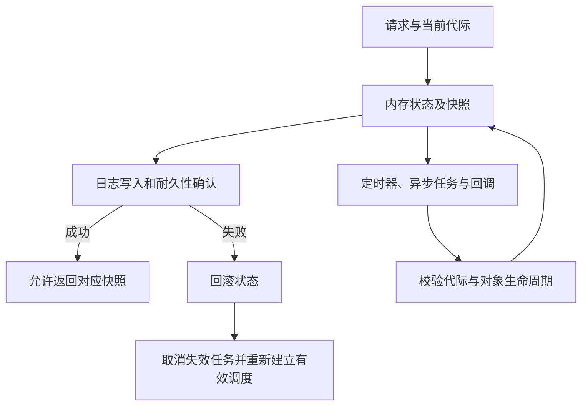

# 流存储技术观察 · 2026-10-23

## 第 3 期：快照发布、失败补偿与协议边界

> 归档范围：本页保存 2026-10-23 报告正文及公开引用，供 GitHub 阅读。GitHub Pages 页面、知识卡与双库同步暂缓；所在目录不表示博客同步已完成。技术状态和原文中的历史交付说明按原观察窗口保留，不代表归档日的最新进展。本次归档未重新核验全部外部链接。

[公开来源索引](../../知识库/sources/web/stream-storage-observer-20261023/README.md)

观察区间：2026 年 10 月 16 日 12:00 至 10 月 23 日 12:00 UTC（北京时间 10 月 16 日 20:00 至 10 月 23 日 20:00）。事件日期统一使用 UTC。检索在本次执行期间完成，精确截止见文末；窗口后的回复不作为本周进展。

[上一期](https://bryantchang1992.github.io/ai_memory_chang_ai_team/stream-storage-observer/2026-10-16/)关注异步失败、协议接线与 WAL 版本演进。本周最重要的变化，不是多了几个接口或优化开关，而是实现开始回答“中间步骤已经发生，后续失败了怎么办”。Kafka 必须让状态回滚与定时器、后台任务一起收敛；Fluss 正把协议与 TLS 设计变成具体读写路径，同时暴露新旧契约之间的缺口；AutoMQ 则在相邻两天修正 metadata snapshot 的发布与耐久性边界。

三个项目并没有采用同一种解决方案。共同的阅读方法是：沿着一次请求追踪状态、异步副作用和持久化确认，判断它们是否处于同一个代际、同一个快照以及同一个失败边界。以下结论以公开原文、评审和最终补丁为依据；设计推断明确标注，不把作者报告的测试当作独立性能测量。

## 本周主线

| 项目 | 核心变化 | 截止时的边界 |
|---|---|---|
| Kafka | 回滚补偿 timer/task；TV2 通过日志写入识别旧协调器；文件读取失败修复落地 | 回滚副作用修复仍在评审；TV2 和文件读取修复合并不等于已发布 |
| Apache Fluss | 服务端 TLS、Kafka DDL/Metadata、Paimon 原地使用与 KV 读锁优化推进 | 客户端与内部 TLS、完整 Produce、Metadata 错误隔离仍有未完成部分 |
| AutoMQ | snapshot 内存发布与 WAL 确认重新分工；CRT 默认实现与生命周期修复 | 多分支合并及 nightly 不等于新的正式版本；恢复优化仍在评审 |

“提出/讨论”仅表示公开提案或评审存在；“接受”需要提案或投票证据；“开发中”表示实现尚未合入；“已合并”注明目标分支；“已发布”要求相应正式发行证据。文中的 merged 均不自动推导 released。

## 一张图：失败时，需要收敛的不止内存状态

这张图是本文的跨项目分析框架，不是任何项目的实际类图，也不表示三者有相同的事务或故障模型。

## Kafka：回滚必须覆盖副作用，旧协调器不能只凭缓存作答

观察窗口：2026-10-16 12:00 至 2026-10-23 12:00 UTC。检索执行于 2026-10-23 12:05–12:10 UTC；正文只采用窗口内事件，12:00 后回复不计入。本期重点是三条正确性主线，不把已讨论过的设计背景重新包装为新增功能。

### 1. 从异步分配的局部补救，走向 coordinator runtime 的回滚边界

上期讨论异步 assignment 时，问题还是“旧计算结果如何拒收、失败后谁再驱动”。本期开始往更底层推进：10 月 20 日建立的 KAFKA-21312 指出，regex 解析、异步 assignment 等任务并不随 coordinator 状态一起回滚；状态已经退回，后台任务却仍可能带着失效输入完成。10 月 22 日打开的 [PR #23923](https://github.com/apache/kafka/pull/23923)，尝试让任务生命周期直接服从 runtime 的写入批次，而不要求每个调用者分别证明所有过期结果都会被挡住。[问题说明](https://www.mail-archive.com/dev@kafka.apache.org/msg159165.html)

这个方案在截稿前已经发生一次关键转向。最初做法是跟踪本批次创建的任务，写入回滚时取消；David Jacot 在 10 月 22 日提出，何不在批次成功写入之前根本不向 executor 提交。10 月 23 日 11:55:12 UTC 的代码更新采用了后者：任务先留在 pending 集合，batch written 后提交，batch reverted 则直接丢弃，避免为最终无效的状态启动计算。没有生成记录、又没有待写 batch 的操作则可以直接提交，不能永远等待一次可能不会发生的后续写入。这里是本地批次“写成”的边界，不应误写成已复制至 high watermark 后才运行。[评审建议](https://github.com/apache/kafka/pull/23923#discussion_r4352497676)；[截点前代码提交](https://github.com/apache/kafka/commit/33fc542ea9d2eb4b5a66ba51653ec972743ea6d6)

但这并不等于“所有副作用都自动可逆”。该 PR 明确保留了一个不对称契约：取消任务不会随取消操作的回滚而复活；调用者仍须在需要时重新调度。这一点对 timer 尤其重要。同期 [PR #23913](https://github.com/apache/kafka/pull/23913) 的 PoC 用 TimelineHashMap 保存 timer 的 deadline、操作与重试配置，回滚后取消所有现存 timer，再按原 deadline 重建。评审质疑全量重建的扩展性，提出同样的 pending/committed 分层；作者在 10 月 23 日 11:55:59 的回复继续讨论“旧 timer 到期而替代 timer 仍待写入”如何处理，并没有形成最终方案。[成本与替代设计](https://github.com/apache/kafka/pull/23913#discussion_r4349756755)；[截点前最后一轮设计回复](https://github.com/apache/kafka/pull/23913#discussion_r4359239838)

timer 也不能简单套用“失败就恢复再执行”：Sean Quah 举出的反例是混合 group 最后一名 consumer-protocol 成员过期，触发向 classic group 降级，但生成的 GroupMetadata 始终超限。若每次写失败都把 timer 恢复成立即到期，便可能形成永久重试循环。另一方面，既有 KAFKA-21279 报告的是相反方向：成员离开时先取消 session timer，append 失败后成员和 ownership 恢复了，timer 却没有恢复，已经退出的成员因而可能持续占有分区。这解释了为什么 task 可以依赖后续 heartbeat 重新驱动，timer 却必须另行证明不会遗失到期事件。[永久失败反例](https://github.com/apache/kafka/pull/23913#issuecomment-6345658764)；[KAFKA-21279](https://issues.apache.org/jira/browse/KAFKA-21279)

本周另一个新补丁把同一原则落实到了容器内部：10 月 17 日的 [PR #23849](https://github.com/apache/kafka/pull/23849) 指出，Streams standby/warm-up ownership 索引虽然放在 TimelineHashMap 中，value 却是原地修改的普通 HashSet。外层 map 回滚不代表集合内容回滚；补丁改为复制集合后替换，配套测试覆盖添加、删除 owner 后的 snapshot revert。问题报告称，失配既可能使本来合法的 active task 永远卡在 UNRELEASED_TASKS，也可能漏掉应恢复的 owner。截止时 #23849、#23913、#23923 均未合并，因此应写成正在补齐的失败语义，而不是已交付的可靠性保证。[报告与复现场景](https://www.mail-archive.com/dev@kafka.apache.org/msg159125.html)

### 2. TV2：让日志写入裁决旧 coordinator，而不是把旧缓存误判成致命事务错误

10 月 20 日 16:42:01 UTC 合并的 [PR #23831](https://github.com/apache/kafka/pull/23831)，补上了事务 coordinator 切换中的另一层竞态。先前 #23630 解决的是 broker 已应用 leadership 变更、缓存尚未清理的窗口；新补丁处理的则是旧 coordinator 连最新 metadata 都还没应用的窗口。分区已经在新 coordinator 加入事务，旧 coordinator 却仍从缓存看到 Empty、CompleteCommit 或 CompleteAbort。原先，它会对当前 epoch 的 EndTxn(COMMIT) 直接回答 INVALID_TXN_STATE，把一个暂时的路由/领导权问题升级为客户端的致命错误。

新方案看似放宽语义，实际上把判断交还给持久化路径：允许 TV2 在这些状态提交一个空事务，提升 producer epoch，写入没有 partitions 的 PrepareCommit，并立即完成，不发送 transaction markers。真正仍持有领导权的 coordinator 只是在提交无数据事务；已经失去领导权的旧 coordinator 无法把这次 acks=-1 的事务日志写入复制成功，客户端就会收到 NOT_COORDINATOR 或 COORDINATOR_NOT_AVAILABLE 这类可重试错误，重新查找 coordinator 后继续。这里关键不是“给所有错误加重试”，而是先通过日志写入建立足够的权威性，再决定能否回答。[实现和状态表](https://github.com/apache/kafka/pull/23831)；[空事务不发送 markers 的评审答复](https://github.com/apache/kafka/pull/23831#discussion_r4298138660)

边界也被刻意保留：TV1 不变；既有重试路径不因“空事务提交”而重写。4.3 回补 [#23884](https://github.com/apache/kafka/pull/23884) 于 10 月 20 日合并，4.2、4.1、4.0 的 [#23885](https://github.com/apache/kafka/pull/23885)、[#23886](https://github.com/apache/kafka/pull/23886)、[#23887](https://github.com/apache/kafka/pull/23887) 于 10 月 21 日合并。特别是 4.0–4.2 尚无 KAFKA-20785，CompleteAbort + Commit + Retry 仍返回原来的 INVALID_TXN_STATE，不能把 trunk 的 PRODUCER_FENCED 描述照搬过去。以上证据证明代码合入这些分支，不证明它们已经进入某个正式发行包。

### 3. Fetch/TLS：两项旧修复本周合并，下一步是不再用重读猜测已知的磁盘错误

上期的零拷贝 Fetch 磁盘错误和 TLS stale buffer 问题，本周有了明确阶段变化：[PR #23445](https://github.com/apache/kafka/pull/23445) 于 10 月 20 日 17:50:53 UTC 合并，[PR #23832](https://github.com/apache/kafka/pull/23832) 于同日 18:10:32 合并。前者把发送失败交回存储层，在后台 scheduler 重读失败区间，只有确认读失败才将日志目录 offline；后者保证 TLS 文件缓冲区无论读取成功还是失败都正确 flip，并立即抛出 IOException，避免把上一块旧内容当作下一块发送。这是本期的新进展，不是两个问题首次被发现。

本周评审还排除了一个有诱惑力的捷径：只重读失败调用起点的第一小块。作者在 10 月 19 日解释，TLS 现在会在已经发送部分字节后仍抛异常，macOS 的 sendfile 也可能丢弃失败 chunk 的部分进度，真正失败位置不一定就在起点。Jun Rao 接受保留整个失败区间重读。因此，“更便宜的验证”不能建立在某个平台的 partial-progress 假设上；这里宁可把额外 I/O 移到后台并按日志目录限并发，也不能漏掉区间中部的读取错误。[完整解释](https://github.com/apache/kafka/pull/23445#discussion_r4317845403)；[评审结论](https://github.com/apache/kafka/pull/23445#discussion_r4318604455)

10 月 23 日 00:33:05 新开的 [PR #23928](https://github.com/apache/kafka/pull/23928)，则把 TLS 和 PLAINTEXT 的信息能力真正分开。PLAINTEXT 的 sendfile 将读文件、写 socket 合在一次调用中，裸 IOException 仍需要重读来分类；TLS 本来就先 FileChannel.read、再加密写网络，因此可以在源头包装 FileReadException，把已知文件读取错误直接交给 LocalLog，正常断连则不必重读。文件关闭/删除产生的 ClosedChannelException 不算介质故障；已知错误上报与“不确定错误的重读”分别限流，避免后者占着槽位时丢掉前者。

这不只是节省 I/O，也会改变故障处置：TLS 首次读失败即使随后能读成功，也将触发目录 offline，而不是被一次成功重读归类为 socket 问题。作者的 Linux 故障注入报告中，三名 TLS consumer 反复中断 Fetch 五分钟，现有 trunk 额外重读 151 MB，新补丁为零；macOS 报告对应为 636 MB 与零。这是作者在具体测试环境中的结果，不是独立验证或生产通用收益。截止时 #23928 仍未合并；PLAINTEXT 仍需重读，走 UnalignedFileRecords 的 KRaft snapshot 也仍不在覆盖范围。[Linux 测试报告](https://github.com/apache/kafka/pull/23928#issuecomment-6354481909)；[macOS 测试报告及位置语义](https://github.com/apache/kafka/pull/23928#issuecomment-6356602013)

### 其他动向：只记录新增及阶段

- **业务 headers 与 DLQ 元数据分开。** 10 月 22 日合并的 [#23659](https://github.com/apache/kafka/pull/23659) 在启用 record copy 时保留原记录 headers，但最终代码始终剔除六个保留的 DLQ context keys，即使本次没有 delivery-count/cause，也不保留上一次 DLQ 的旧值。10 月 20 日发起的 [KIP-1383](https://cwiki.apache.org/confluence/spaces/KAFKA/pages/451980224/KIP-1383+Standard+record+headers+for+content+type) 则提议用 __ct.k / __ct.v 描述 key/value 内容类型，并对 serializer/deserializer 加开关。4.x 默认关、5.0 默认开的安排仍只是讨论稿，不是已承诺的版本行为。[发起邮件](https://www.mail-archive.com/dev@kafka.apache.org/msg159184.html)
- **配置策略的争论不是加两个 getter 就结束。** 10 月 16 日 12:03:55 UTC 开始讨论的 [KIP-1382](https://cwiki.apache.org/confluence/spaces/KAFKA/pages/451979367/KIP-1382+Expose+Explicit+Configuration+Deletions+to+AlterConfigPolicy)，原稿以 deletedConfigs() 暴露 no-op DELETE，保留 configs() 兼容行为；Edoardo Comar 反对继续扩展有先天限制的旧接口。作者当晚转而愿意讨论保留旧接口、另建能区分“显式操作、当前状态、拟议状态”的配置策略契约。后续正文应以邮件的未决状态为准，不能把较早 wiki 草案当成已达成共识。[评审意见](https://www.mail-archive.com/dev@kafka.apache.org/msg159113.html)；[作者回应](https://www.mail-archive.com/dev@kafka.apache.org/msg159119.html)
- **禁用新写入的 codec 不等于删掉历史解码能力。** 10 月 16 日 12:05:16 UTC 发起的 [KIP-1381](https://cwiki.apache.org/confluence/spaces/KAFKA/pages/451979375/KIP-1381+Allow+Brokers+to+Disable+Compression+Types+for+Client+Writes) 提议 broker 级 compression.disabled.types，在解压前检查 producer 编码及目标重压缩编码；历史读取、复制、compaction 和内部写入不随之禁用。它解决的是新客户端写入的准入，不是历史数据修复或卸载 codec 库，状态仍为讨论中。[发起邮件](https://www.mail-archive.com/dev@kafka.apache.org/msg159108.html)

发布状态还需单独核验：10 月 20 日的社区询问与回复显示 Maven 工件可见性曾先于公告和文档；[站点文档 PR #925](https://github.com/apache/kafka-site/pull/925) 已于 10 月 21 日合并，因此不能继续引用“文档尚未就绪”作为截止日状态。本次未完整确认 4.4 的正式公告，不自行指定发布日期。[当时询问](https://www.mail-archive.com/dev@kafka.apache.org/msg159187.html) · [当时回复](https://www.mail-archive.com/dev@kafka.apache.org/msg159189.html)

## Fluss：从协议接线推进到可发现性，湖表接管与 KV 并发开始碰到真实边界

本周 Fluss 的进展不是一个可以笼统宣布“已支持”的大功能，而是几条关键路径开始进入 main：TLS 服务端真正接上线，Kafka 客户端能够发现显式开放的 Fluss 表，既有 Paimon 日志表可以原位接入，KV 读取也开始缩短持锁时间。与合并同样值得关注的是边界：客户端 TLS 和 Produce 写入尚未完成，Metadata 的 ZooKeeper 负载与批量错误隔离另留后续，湖表接管不能绕过快照与 schema 检查。

### TLS：整块复制改成按连接分块，先拒绝尚不能工作的内部加密

上期仍在评审的 [#4644](https://github.com/apache/fluss/pull/4644) 已于 **10 月 23 日 05:59 UTC** 合入 main。它在 TLS listener 的协议帧解码与认证前插入 SslHandler，并在启动阶段校验密钥和 listener 配置。这是此前 SSL 配置、context 工厂真正进入服务端运行路径的一步，而不是完整 TLS 集群已经交付。[合并提交](https://github.com/apache/fluss/commit/410efb95518a5f3af43956d42114bb17a91841c2)

本周评审带来的实质变化是内存边界。旧方案先把整个 FileRegion 复制入内存，再交给只接受 ByteBuf 的 SslHandler；**10 月 18 日**的评审指出，默认单个 Fetch 响应可达 16 MB，多消费者或 follower 并发时会累积大块内存。最终实现采用 ChunkedWriteHandler，以 **32 KiB** 为单位复制，并随 socket 可写性推进，而不是先物化整个响应。TLS 仍然放弃这条日志读取路径原来的零拷贝能力；分块约束的是额外缓冲规模，并没有消除复制和加密成本，也没有新的端到端吞吐数据。[评审与 10 月 19 日作者落实回复](https://github.com/apache/fluss/pull/4644#discussion_r4309186994)

上期留下的两个正确性问题也有了明确选择。复制中途失败会关闭连接，避免已经发出的响应头与不完整正文污染后续帧；在 Fluss client 与服务端出站连接尚不会 TLS 时，配置 internal listener 为 TLS 将在启动时直接被拒绝，而不是让集群运行到互联失败才暴露问题。[失败关闭的落实](https://github.com/apache/fluss/pull/4644#discussion_r4313105169) · [内部 listener 的落实](https://github.com/apache/fluss/pull/4644#discussion_r4313107947)

证书 DN 到 principal 的 [#4641](https://github.com/apache/fluss/pull/4641) 也于 **10 月 18 日 23:03 UTC** 合并，但映射器不是 mTLS 认证本身。作者 **10 月 19 日**说明，将在后续 authenticator 中只把简化错误返回客户端，把完整映射规则留在服务端日志；这仍是后续处理承诺。[回应](https://github.com/apache/fluss/pull/4641#discussion_r4313019973) 截止时客户端接线 [#3797](https://github.com/apache/fluss/issues/3797) 与 mTLS 插件 [#3793](https://github.com/apache/fluss/issues/3793) 均 open。准确阶段是“服务端加密和身份映射组件已 merged，端到端 TLS/mTLS 待补齐”，不能把 FIP-29 的 accepted 等同于可直接部署的完整安全方案。

### Kafka：DDL 与 Metadata 已合并，但可发现不等于可写入

上期只有传输框架合并，本周依次推进到 **10 月 17 日的 ApiVersions [#4260](https://github.com/apache/fluss/pull/4260)**、**10 月 19 日的 DDL 映射 [#4277](https://github.com/apache/fluss/pull/4277)**，以及 **10 月 23 日 06:15 UTC 的 Metadata [#4261](https://github.com/apache/fluss/pull/4261)**。在固定的 Metadata 合并提交中，生产 KafkaRequestHandler 已注册 ApiVersionsHandler 和 MetadataHandler，而非“除 API_VERSIONS 外都是空 handler”。但也确实只有这两项，Produce 尚未注册。[固定提交的入口代码](https://github.com/apache/fluss/blob/737a93d1b665a5ac36a1fa293ec6e76b73ba01f7/fluss-kafka/src/main/java/org/apache/fluss/kafka/KafkaRequestHandler.java)

DDL-first 的约束因此开始变成实际服务端校验：只允许无主键、非分区的 Arrow log table，且必须显式持久化 `table.kafka.enabled=true`。`database.table` 是完整名称，裸名只对应配置的默认库；Metadata 不是自动建表接口。对同一表的完整名称和别名，线上 UUID 使用不同命名空间，但仍回到同一 Fluss table ID 和 bucket，避免 Kafka cache 同时缓存两种名称或表删除重建后发生身份混淆。当前 Metadata 支持 **v0–v11**，不支持 v12，也不接受 v10/v11 的仅 topic ID 查询。[DDL 最终指南](https://github.com/apache/fluss/blob/dbd6dd731331567cbfb28ef2db004a0e25c76407/website/docs/kafka-compatibility.md) · [Metadata 版本与别名测试说明](https://github.com/apache/fluss/pull/4261)

这里还需要更新上期对 rescue 的描述。**10 月 17 日**评审要求所有可能被置空的字段递归 nullable，MAP key 保留 Fluss 的非空约束；合并后的文档将未知字段、不可转换值及 flat 布局的系统名冲突都纳入 `_kafka_rescue`，转换失败的对应字段置 null。它不再只是保留未知字段。代价是 Kafka-enabled 表不能用业务字段的 NOT NULL 强约束来兜底，应用需要检查 rescue 内容；非法 JSON 和非对象根仍失败。**这是已合并的 DDL 合同和目标转换语义，不代表未合并的 JSON Produce 已提供了该行为。**同一版 `_kafka_metadata` 仅含 timestamp、timestamp_type、partition，日志 offset 没有物化为 row 字段。[nullable 评审](https://github.com/apache/fluss/pull/4277#discussion_r4302291097) · [合并时的完整合同](https://github.com/apache/fluss/blob/dbd6dd731331567cbfb28ef2db004a0e25c76407/website/docs/kafka-compatibility.md)

Metadata 的下一道门槛是控制面负载和一致读视图。**10 月 22 日**评审指出，all-topics 路径遍历 ZooKeeper 的数据库和表，逐表解析还可能再读 descriptor/schema；客户端越多、目录越大，发现请求对 ZK 的压力越高。把目录读取与缓存路由混用，再全请求重试，也不能保证表删除竞态下健康 topic 不被连带失败。最终合并仅保留 native batch 查询并去掉整次重试，**没有把这些问题全部解决**。[评审](https://github.com/apache/fluss/pull/4261#discussion_r4345366418)

新建的 [#4807](https://github.com/apache/fluss/issues/4807) 因此单独要求：在 TabletServerMetadataCache 中只缓存每表的 `table.kafka.enabled` 布尔值，与 routing snapshot 同步构造稳定视图；稳态请求不再扫 ZK，也不逐表重新读 schema；失败要隔离到 topic。该 issue 明确记录，截至目前 native batch lookup 的一次失败仍能使整次 Kafka Metadata 失败。这比 PR 正文里较早的错误隔离描述更准确。

截止时 Produce 协议处理 [#4284](https://github.com/apache/fluss/pull/4284) 仍 open，其本身也把生产注册、Row 转换和 native append 留给后续；认证及 session 传播同样不在本次 Metadata 交付内。因而本周可以宣布“表映射与发现路径已合并”，不能宣布 Kafka producer 的端到端写入完成，更不能延伸成 Fetch、消费者组、幂等或事务兼容。[分阶段总跟踪](https://github.com/apache/fluss/issues/4185)

### Paimon 原位接入：保留历史文件，还必须守住快照交接点

**10 月 22 日 11:48 UTC 合并的 [#4619](https://github.com/apache/fluss/pull/4619)** 实现了既有 append-only Paimon 表到 Fluss lake-enabled log table 的原位接入。历史数据留在 Paimon，不先重写一遍，也不批量导入 Fluss；过程派生 Fluss schema、bucket 和 partition 配置，建立 Fluss 元数据，登记初始 lake snapshot，再开启 lake reads。新增的最终 Admin API 名称是 `createTableFromLake`，不是 PR 较早描述里的 `createTableOnLake`；它成功只表示元数据创建，procedure 才继续执行后续交接。[合并提交](https://github.com/apache/fluss/commit/37e4462192fcb9423c0120e90d6493420c869c84) · [最终 procedure](https://github.com/apache/fluss/blob/37e4462192fcb9423c0120e90d6493420c869c84/fluss-flink/fluss-flink-common/src/main/java/org/apache/fluss/flink/procedure/EnableFlussOnLakeTableProcedure.java)

“原位”省去历史重写，并不意味着可以与原 Paimon writer 无协调双写。操作要求先停止原生 Paimon 写入和直接 schema 变更，之后通过 Fluss 写入。登记与启用之间若 Paimon 发生 APPEND 或 OVERWRITE，快照交接点已经改变，不能静默接管；只有后续快照均存在且不改变数据时才允许继续，例如纯 COMPACT。最终代码还在 snapshot ID 相等的快捷返回之前检查已登记快照是否仍存在，避免“数据未变，所以没问题”却读到已过期 snapshot 的假安全。[10 月 21 日评审](https://github.com/apache/fluss/pull/4619#discussion_r4339257498) · [合并时快照校验](https://github.com/apache/fluss/blob/37e4462192fcb9423c0120e90d6493420c869c84/fluss-lake/fluss-lake-paimon/src/main/java/org/apache/fluss/lake/paimon/PaimonLakeCatalog.java)

中途失败也不能简单等同于“重复调用即可”。最终 procedure 已补上“Fluss 表已创建，但初始 lake snapshot 尚未登记”的恢复分支：重新查询已登记快照，有则保留，无则补登记，再走一致性检查。这里应以最终代码为准，PR 正文仍残留“需要重试覆盖”的旧提醒。另一个边界尚未解决：Paimon 的嵌套 VARCHAR/VARBINARY 被递归转成 Fluss STRING/BYTES，但兼容检查只归一化顶层，ARRAY、MAP、ROW 中的相应类型会在元数据已经创建后失败，重试仍失败。跟进 [#4805](https://github.com/apache/fluss/pull/4805) **10 月 22 日**提出递归归一化，截止仍 open。

这一批交付仅覆盖 append-only 表。主键表必须先建立可服务的当前 KV 状态，其 recoverable bulk-load transaction [#4771](https://github.com/apache/fluss/pull/4771) 仍 open，不能从 FIP-25 的完整设计推断所有表型都能接管。Iceberg 原位升级讨论在 **10 月 18 日、20 日 UTC**重新有回应，作者说方案将构建于 FIP-25 之上；这属于设计继续推进，不是 Iceberg 提升已经实现。[邮件原文](https://go.mail-archive.com/dev@fluss.apache.org/msg01535.html)

### KV 读取：减少 JNI 往返之后，锁外执行还需要固定视图和资源寿命

本周先补完了上期的 cache 分支。**10 月 20 日 01:53 UTC 合并的 [#4612](https://github.com/apache/fluss/pull/4612)** 将 per-DB block cache 也切到 AutoHyperClockCache，并增加可选 partitioned index/filter；`kv.rocksdb.block.partitioned-index-filters` 默认仍是 false。启用 metadata caching 不等于自动启用分区索引，关闭此选项也不会重写旧 SST 或立即改变旧文件的缓存行为。作者验证的是普通/分区 SST 混读、开关往返与 checkpoint restore 兼容性，明确没有受控性能基准，不能把“减小元数据 miss 成本”的动机写成已测得收益。

随后两次合并分别减少执行工作和缩短互斥边界。**10 月 21 日 02:32 UTC 的 [#4744](https://github.com/apache/fluss/pull/4744)** 用 RocksDB 原生 `iterate_upper_bound` 表达任意 byte prefix 的右开区间，不再逐行跨 JNI 复制 key 仅为检查前缀。上界由最右侧非 0xff 字节加一、去掉后缀得到；空前缀和全 0xff 前缀没有有限上界。它保留 total-order seek，因为任意长度的编码前缀不等于 prefix extractor 的语义；当前 Fluss 也未配置 extractor，不能将这次改动描述为禁用了一个已启用的 prefix Bloom 优化。[评审澄清](https://github.com/apache/fluss/pull/4744#discussion_r4324562107)

**10 月 21 日 19:53 UTC 的 [#4749](https://github.com/apache/fluss/pull/4749)** 再把 seek、遍历、状态检查和值转换移出 KV read lock。锁内先创建 iterator，固定该次 prefix lookup 的 RocksDB 读视图，并持有 ResourceGuard lease；锁外执行时写入和异步 flush 可以继续，关闭则要等活动读取释放资源。iterator/read options 必须先关闭，再释放 lease，drop 也必须等真正物理关闭完成后才删目录。这是把“一把锁同时保护可见性和寿命”拆开，而不是不再需要一致性保护；Replica leader/ISR 的外层读锁范围保持不变。

普通 MultiGet 的对应方案 [#4768](https://github.com/apache/fluss/pull/4768) 于 **10 月 21 日**提出，截止仍 open。它不能照抄 iterator 的隐式固定视图：一次逻辑 flush 可能包含多个 native writes，所以较大批次先取得显式 snapshot 和 lease，再到锁外执行。当前草案以 16 keys 为阈值，小批仍在锁内，以避免 snapshot/lease 的固定开销。

作者在 Apple M4、ARM64 JDK 11、固定数据集和固定写入速率下报告，256-key、七读线程加一写线程时，128 MiB cache 的平均写锁获取时间从 **636.9 μs 降至 5.61 μs**，读吞吐约 **+1.27%**；4 MiB cache 下分别为 **2,018.4 μs→5.46 μs**、**+6.58%**。这首先说明锁争用被隔离，不是集群吞吐翻倍。相同研究中强行使用 snapshot 路径的单 key 纯读吞吐下降约 6.39%，16-key 纯读也仍付出约 2.90% 的成本，才形成按批量大小分流的取舍。**这些都是作者的 native KV/JMH 测量，未独立复验，排除了 WAL、RPC 与复制；小缓存 miss 也可能由 OS page cache 命中，不能外推端到端延迟。**

综合来看，本周 Fluss 更可靠的进度表述是：服务端安全与 Kafka 发现路径已进入 main，Paimon append-only 接管有了实现，KV 优化开始把可见性、寿命与锁争用分别处理；而完整生产承诺仍取决于尚未闭合的客户端、写入、缓存一致视图和恢复路径。本窗口未核实新的正式 release，上述合并不应倒算进既有 [v1.0.0](https://github.com/apache/fluss/releases/tag/v1.0.0)。

## AutoMQ：从“完成一个 future”到“完成一次可恢复的状态交接”

本周 AutoMQ 的主线不是继续增加对象存储并行度，而是把异步边界补完整：快照取到的元数据必须和 offset 属于同一时刻；HTTP 请求返回 publisher 不等于 body 已读完；WAL 中很小的 link record 也不代表恢复时只占很少内存。另有一组重启延迟改进进入评审，但维护者明确要求将组合收益拆成可单独验证的问题。以下事件均位于 2026-10-16 12:00 至 2026-10-23 12:00 UTC。

### 快照修复一周内再修正：一致取样不能只靠“等 ACK”

上期追踪的 [#3647](https://github.com/AutoMQ/automq/issues/3647) 已不再只是报告者的猜测。10 月 21 日，维护者确认 retention 删除后 ZeroZone 空闲分区的 snapshot-read 副本可能保留旧 segment 列表；[#3677](https://github.com/AutoMQ/automq/pull/3677) 当日 02:26:24 合入 main，并通过 [#3678](https://github.com/AutoMQ/automq/pull/3678)、[#3679](https://github.com/AutoMQ/automq/pull/3679) 同日进入 1.8、1.7。第一版修复集中在通知顺序：元数据 append 成功后，先刷新 cached logMeta，再通知快照管理器，而不是 segment 一删除就先增加版本号。这样没有后续 append 的分区也能推送删除后的列表。[维护者确认及计划版本](https://github.com/AutoMQ/automq/issues/3647#issuecomment-6306245802)

作者给出了比上期更具体的对照：本地 DevKit 三 broker、三 AZ、RF=1，写入 640 条 4 KiB 记录后停止写入，再用 retention 删除 41 个 segment。旧实现的异区副本停在 offset 0 并重复返回 UNKNOWN_SERVER_ERROR；修改版两次从干净集群测试，两个读取 AZ 都推进到 leader 的 615，旧消费者可以 reset，新 earliest 消费者从 615 读起。这是作者的功能回归，不是本期独立复验或生产可靠性证明。[完整条件与结果](https://github.com/AutoMQ/automq/pull/3677)

但这不是本周最终实现。10 月 22 日的 [#3691](https://github.com/AutoMQ/automq/pull/3691) 指出，单纯把 cache 发布推迟到 ACK 后仍有两个竞态。其一，已经从 segment A 滚到 B，B 的 metadata append 尚未确认，快照却可能把旧 cache A 和 B 的新 offsets 一起取走；事后等 future 完成，也修不好已经捕获的混合状态。其二，WAL 的 ACK 即使有序，注册 ACK callback 的线程仍可能交错：B 的 callback 先发布新 cache，A 随后在已完成 future 上注册 callback，又把 cache 写回旧版本。

最终方案把“取一致内存快照”和“等待持久化”拆开：在 segment lock 内串行完成 metadata 捕获、cache 发布、通知及 metadata append 提交；ACK callback 不再负责回写 cache。segment.meta() 返回副本，避免后续 append 或 seal 改变已经发布的内容；快照增量判断比较实际捕获的 metadata，而不是只比较 segment 版本计数。同步基线保存“捕获前的 record version + 实际捕获的 metadata”，让捕获后并发发生的 record 通知仍能驱动下一次快照。[最终实现与两个反例](https://github.com/AutoMQ/automq/pull/3691)

这不等于取消异步等待。正常路径仍等待捕获的数据 append futures，作者以 WAL 有序 ACK 覆盖前置 metadata append 解释其耐久顺序；main 的截断流程也仍在 ACK 后安装 segment。但不可把它扩大成“任何失败都拒绝返回快照”：合并后的 main 源码对这些 futures 的异常仍记录 WARN，然后返回已收集的 delta。这是现存的异常处理边界，不是本期已验证的严格失败隔离保证。[不可变源码：取样、等待与异常返回](https://github.com/AutoMQ/automq/blob/fbf3af737d05796180102c0c337748e5aa80cc5d/core/src/main/java/kafka/automq/partition/snapshot/PartitionSnapshotsManager.java#L385-L460)

这里的工程要点是：一致性必须在取样时成立，之后还要分别检查“等待了什么”与“等待失败如何处理”，不能把它们混成一个“future 已完成”。[#3691](https://github.com/AutoMQ/automq/pull/3691) 于 10 月 22 日 09:18:55 合入 1.7，[#3692](https://github.com/AutoMQ/automq/pull/3692)、[#3693](https://github.com/AutoMQ/automq/pull/3693) 随后进入 main、1.8；main 回移保留版本化 metadata codec、deep copy 和原有截断语义。[main 适配说明](https://github.com/AutoMQ/automq/pull/3692#issuecomment-6337566405) 因此不能把 21 日的“ACK 后才发布”当成截点时的最终保证。[最终发布顺序源码](https://github.com/AutoMQ/automq/blob/fbf3af737d05796180102c0c337748e5aa80cc5d/core/src/main/scala/kafka/log/streamaspect/ElasticLogSegmentManager.java#L147-L200)

### 默认改为 CRT HTTP：绕开 Netty 的失败路径，也要重新定义健康检查

上期 CRT 还是逐桶 opt-in；本周 main/1.8 的默认路径发生实质变化，且一天内经历两步。10 月 21 日 04:07:55 的 [#3680](https://github.com/AutoMQ/automq/pull/3680) 先默认选用 native CRT S3 client；09:07:35 的 [#3682](https://github.com/AutoMQ/automq/pull/3682) 再改成 Java S3 client 加 CRT HTTP transport，即 sdkImpl=crt-http，并由 [#3683](https://github.com/AutoMQ/automq/pull/3683) 同日回移到 1.8。最终方案不是笼统的“全面替换 Java SDK”：S3 请求、重试和扩展仍由 Java SDK 承担，底层连接管理交给 CRT；native CRT S3 继续是 sdkImpl=crt，Netty 则可显式选择。1.7 仍默认 Netty，没有一起切换。

推动它的两个问题都涉及失败后的继续前进。[#3675](https://github.com/AutoMQ/automq/issues/3675) 报告，在 DNS 返回多个 IP 时，Netty 重试可能一直连向被拒绝的那个地址；维护者选择让 SDK transport 负责地址轮换，AutoMQ 自行维护 refused-IP 隔离表的 [#3676](https://github.com/AutoMQ/automq/pull/3676) 于 10 月 21 日关闭、未合并。另一条 [#3664](https://github.com/AutoMQ/automq/issues/3664) 更隐蔽：收到响应头后，body 尚未读满 Content-Length 就遇到正常 TCP FIN，SDK 检出长度不符，却没有向 body subscriber 发终止信号。AutoMQ 真正持有 read permit 的 future 因此永久 pending；外层两分钟超时只完成另一个返回 future，既不能触发内层清理，也不能恢复 permit。

10 月 21 日的维护者验证报告称，走 CRT HTTP 后，同样的截断 FIN 能传播 body error、触发 AutoMQ 重试，使 permits 从 50→49→50；Netty 对照仍卡在 49。这里关闭的是 AutoMQ 默认路径的问题，不是修好了 Netty。上游 [AWS SDK #7465](https://github.com/aws/aws-sdk-java-v2/issues/7465) 截止仍 open，AWS 仅回复正在调查；显式选 sdkImpl=netty 仍有这条风险。[完整 read/retry/permit 验证](https://github.com/AutoMQ/automq/issues/3664#issuecomment-6312017383)

新路径保留 API-call/attempt timeout 配置，但不能把它们写成覆盖完整 body 生命周期的绝对 deadline；publisher 返回后的停滞仍要靠连接健康检查。代码同时升级 AWS SDK 到 2.57.1、aws-crt 到 0.48.5，并保留 batch delete 等操作需要的 Content-MD5。作者报告了 MinIO、COS、OSS 的 Linux ARM64 冒烟及 FIN/RST、503、DNS 拒绝、body 停滞测试；吞吐、稳态 native memory、代理与私有 CA 兼容仍需部署侧验证。[实现、测试与限制](https://github.com/AutoMQ/automq/pull/3682)

健康检查很快暴露了控制面与数据面的差异。10 月 23 日 07:46:07 合并的 [#3695](https://github.com/AutoMQ/automq/pull/3695) 解释：默认每连接 32 MiB/s、两秒窗口适用于观察数据传输，但 LIST、DeleteObjects、Create/CompleteMultipartUpload、UploadPartCopy 可能在 S3 内部处理很久，客户端连接却几乎没有字节。把这种安静当成坏连接，会让恢复 WAL 所需的 LIST 失败，甚至阻止 broker 启动。

最终修复不是全局放松大对象传输探测，而是为这些低吞吐操作惰性创建、共享一个 control client，将最低吞吐阈值设为不高于 1 B/s、窗口至少 30 秒，保留用户更宽松的设置；真正传输内容的 UploadPart 仍留在 write client。LIST 分页复用同一个 control client，创建与关闭互斥，避免 shutdown 后重新创建资源。[10 月 23 日评审中的操作划分](https://github.com/AutoMQ/automq/pull/3695#issuecomment-6359723618) 这会增加至多一个按需 client，是以额外连接资源换取不同操作类别的合理失败判定，而非提升了所有 S3 请求的超时上限。当天 [#3696](https://github.com/AutoMQ/automq/pull/3696)、[#3697](https://github.com/AutoMQ/automq/pull/3697) 已分别进入 1.7、1.8；1.7 回移只修 optional native CRT，没有引入 CRT HTTP。

另外，10 月 22 日的 [#3689](https://github.com/AutoMQ/automq/pull/3689) 及 [1.8](https://github.com/AutoMQ/automq/pull/3688)、[1.7](https://github.com/AutoMQ/automq/pull/3690) 对应修复，给每个成功构造的 CRT-backed storage 持有 shutdown reference，关闭 client 后才释放，防止并行 JVM shutdown hooks 在 Kafka 尚未 flush WAL 时提前拆掉 native runtime。切换 transport 的代价不仅是性能参数，还有整个进程退出阶段的资源所有权。

### WAL 恢复按解码后的字节收费，上传批次再划出硬边界

10 月 17 日 02:02:35 合入 main 的 [#3661](https://github.com/AutoMQ/automq/pull/3661) 修复了“WAL 记录很小，恢复结果很大”的预算漏洞。ZeroZone link record 只存引用；恢复原先按编码后的 link 大小填 cache block，再把 link 换成实际 payload，却没有同步扩大核算值。许多小引用可以在解码后膨胀到远超 recovery cache 预算；同一 stream 的总 payload 超过 int 上限时，上传 size 变成负数，rate limiter 报 permits 必须为正，启动或故障恢复就可能被阻断。

修复在发起 decode 前使用 decodedSize 的保守估计，并用 long 加上 record overhead，先决定 block 边界再分配 payload；暂存到下一块的记录只在真正插入后推进 stream/WAL offsets，decode 或上传失败时也要释放。借用 ByteBuf slice 读取 link 内 offset，则避免每次估算额外分配一个未释放 buffer。配置 cache 阈值仍是允许末条完整记录跨过的软预算，不能把它误写成严格的最大瞬时内存保证。[恢复路径及评审](https://github.com/AutoMQ/automq/pull/3661#discussion_r4298333726)

10 月 19 日 06:50:33 的 [#3663](https://github.com/AutoMQ/automq/pull/3663) 把边界进一步贯穿正常 append、恢复、上传和读取：同一 stream 在一次 WAL upload batch 中的 payload 最多 1 GiB；不可拆的超大记录在写 WAL 前拒绝；累积 upload/read byte totals 改为 long。编码 header、data/index/footer 仍可能让单个 CompositeByteBuf 超出 int 容量，所以 writer 在容量边界前拆分，multipart 的非末尾 part 还必须满足最小尺寸。这里的 1 GiB 不是整个 bucket、topic、S3 object 或合并后的只读 cache 的总量限制。

这两项已经通过 [#3666](https://github.com/AutoMQ/automq/pull/3666)、[#3667](https://github.com/AutoMQ/automq/pull/3667) 于 10 月 19 日回移到 1.7、1.8。收益首先是避免溢出和不可恢复的 admission 状态，不是已经测得更快恢复；边界测试以小 buffer 和 mocked size 模拟 GiB 数值，没有真实分配超大负载。单个 index block 的格式容量以及 AutoMQVersion V2 以下的 controller metadata 格式也不在 #3663 的覆盖范围。把计数改为 long，并不等于底层所有格式都获得了无限容量。

### 重启 p99 改善仍是组合实验：维护者要求逐项证明

10 月 19 日新建的 [#3669](https://github.com/AutoMQ/automq/issues/3669) 记录，broker readiness 已恢复，应用写延迟和异区 snapshot-read 可见性却仍未恢复。报告者比较的是同一 upstream 1.7 commit b64f16834f5b 上的两个构建：两边都开启其 cross-rack 扩展，修复版再加入协调、调度、balancing 的组合修改。更新后的三次受控重启中，峰值 write p99 从 4.43–8.85 秒降至 2.18–2.29 秒，reader-delay p99 从 15.25–28.25 秒降至 3.15–3.53 秒。取值是 shutdown 开始后五分钟内、15 秒步长的一分钟 histogram rate 所估计的 per-pod p99 峰值，不是整个恢复周期的精确尾延迟分布。

这些数字不能直接写成“AutoMQ 新版将恢复提速若干倍”。作者明确说明，两组 partition ownership、工作负载分布、record size、read traffic、cache 状态并未完全受控；两边均有 cross-rack，不足以测出该选项的单独收益；shutdown 和 replacement readiness 时间也没有一致改善，strong-read enforcement failures 仍出现，未验证端到端逐字节完整性。10 月 21 日 11:32:24，维护者要求把每个触发条件、证据、方案代价与独立验证拆到子问题，再逐项推进，而不是依赖组合数字接受整组修改。[要求拆分因果证据的回复](https://github.com/AutoMQ/automq/issues/3669#issuecomment-6314869589)

10 月 20 日拆出的五张 PR 截止都仍 open，但机制值得跟踪：

- [#3670](https://github.com/AutoMQ/automq/pull/3670) 在 snapshot replica 删除或替换后重新检查 delayed Fetch/Produce，先发布新映射，再在 map compute callback 外检查，防止旧 replica 已不能服务、请求却一直等满 long-poll timeout，也避免 map/purgatory 锁序倒置。
- [#3671](https://github.com/AutoMQ/automq/pull/3671) 协调已接受 append 与 delayed-Produce 注册，unhost 前排空 durable callbacks；失败响应等待可用 leader hint 最多一秒、最多容纳 64 个，保持原错误和请求预算，而不是把重试提示当作成功确认。
- [#3672](https://github.com/AutoMQ/automq/pull/3672) 将恢复优先级穿过 router 和 physical WAL 的多层 batch，限于每滚动分钟最多三次、每次约三分之二秒的 burst，batch 等待上限 50 ms；跨 session 合并 snapshot cache-pressure commits。更短 batching 可能增加 PUT 次数，报告数字也不是该 main port 的单项测试。
- [#3673](https://github.com/AutoMQ/automq/pull/3673) 拟给可选 rebalance 加默认五分钟 reassignment cooldown，并等待跨越 rate meter 五秒 tick 的完整新负载报告；不阻止 mandatory recovery 或慢源疏散。恢复节点早期报零不再能被简单当作空闲容量。
- [#3674](https://github.com/AutoMQ/automq/pull/3674) 是默认关闭的 cross-rack controlled-shutdown placement，保留原有分批节奏与 crash/fencing 策略，需要 controller 配置一致并重启；它用可能增加的跨 AZ 流量和费用，换取少数同 rack 目标上的负载不过度集中。

前三项存在堆叠依赖，后两项可独立评审。维护者还说明 1.7 不再计划大的功能变更，贡献应面向 main，主要变化进入 1.8。[分支方向](https://github.com/AutoMQ/automq/issues/3669#issuecomment-6305822654) 本期能确认的是问题公开、方案拆分及验证要求，不能把它写成已合并或即将确定交付的恢复 SLA。

### 交付边界与上期线索

本周未发现新的版本化 release。最近仍是 9 月 24 日的 [1.7.5-rc1](https://github.com/AutoMQ/automq/releases/tag/1.7.5-rc1)；[nightly](https://github.com/AutoMQ/automq/releases/tag/nightly) 是滚动条目，截点前最近更新为 10 月 22 日 20:05:58 UTC。因此 23 日上午才合并的控制请求 health-check 修复，不能倒算进该晚 nightly。维护者称 snapshot 修复计划进 1.7.5、默认 CRT HTTP 修复预计进 1.8.0，均是发行计划，不是已经 released。

上期其他线索也有区别：原 fast-retry [#3640](https://github.com/AutoMQ/automq/pull/3640#issuecomment-6230395627) 10 月 17 日以已有替代变更为由关闭、未合并，不能因此宣称原 GET cancellation/permit 争议全部闭环；IPv6 [#3639](https://github.com/AutoMQ/automq/pull/3639#issuecomment-6321689093) 10 月 21 日按维护者要求保留既有非标准 IPv4 解析行为，避免把 IPv6 支持与收紧历史配置混成一次不兼容升级，截止仍 open。TableTopic [#3646](https://github.com/AutoMQ/automq/pull/3646) 已于 10 月 21 日合入 main，允许新生成 schema 不带三个 Kafka 附加列，但不会自动删除旧 Iceberg 列或历史数据。

最值得继续核验的，是快照最后一轮改法在失败持久化与并发 roll 下的回归、CRT HTTP 在真实代理/私有 CA 与低吞吐控制请求下的行为，以及重启改进能否给出逐项、同负载的因果验证。合并代码、作者的功能测试和正式发行，是三个不同层次。

## 下周真正需要追问什么

本周不能被一个统一的“成熟度提升”概括。Kafka 正在把副作用纳入回滚边界，但如何重建 timer 而不进入永久重试仍未决；Fluss 已经合并接口与运行组件，却还需要证明完整协议路径和控制面负载可承受；AutoMQ 的连续修正说明，一致取样、持久化等待和失败响应必须分别审视。

本文的分析推断是：评审时最值得画出的并非正常路径，而是“状态已经变了，某个 future 尚未完成”的瞬间。此时仍有效的对象是谁、已经对外发布了什么、失败后谁负责下一次驱动，决定了局部优化能否成为可靠系统行为。这个判断不代表三个社区形成了共同设计共识。

## 检索范围、时间与局限

- 事件窗口固定为 2026-10-16 12:00 至 2026-10-23 12:00 UTC；正文来源检索截止为 2026-10-23 12:15 UTC。检索发生在窗口结束之后，不把后到回复计入事件。例如 Kafka #23913 的 12:01:30 回复和 #23923 的 12:06:17 回复均排除；延后 task 提交的判断来自 11:55:12 的代码提交。
- Kafka：检索官方仓库窗口内新 PR 96 条、合并 PR 57 条，并补查近期更新 PR、dev 邮件日期索引及相关 KIP；数量含回补、测试和文档，不等于独立功能。核心 PR 阅读说明、关键回复与补丁。ASF 原归档/Jira 部分访问失败时，使用原 dev 邮件在 mail-archive 的公开镜像，不把搜索摘要当原文。
- Fluss：按更新及合并检索仓库 PR/issues，读取核心主题完整评审与最终提交，检查 dev 邮件和 FIP。FIP-52 本周可见回复仅确认继续推进，长篇旧引用不是新决议；FIP-55 未核实新的 RESULT，不能据此断言已接受或确定未接受。[FIP-52 本周回复](https://go.mail-archive.com/dev@fluss.apache.org/msg01530.html)
- AutoMQ：获取窗口相关 40 个 PR 的说明和状态、6 个 issue 全文，对选定主线阅读评论、评审及最终生产补丁和回归测试；扩查官方组织和 releases。仓库未启用 GitHub Discussions，设计讨论主要在 issue/PR；未找到可独立展开的新正式版本，不据此断言所有渠道都没有活动。
- 这是公开材料观察，不是全集群测试或性能复现。文中基准均归属于作者报告，合并状态仅证明代码进入相应分支。本期不重复技术调研周报的顶会论文/技术博客选题，不转载完整原文，不使用私有训练或内部材料。
