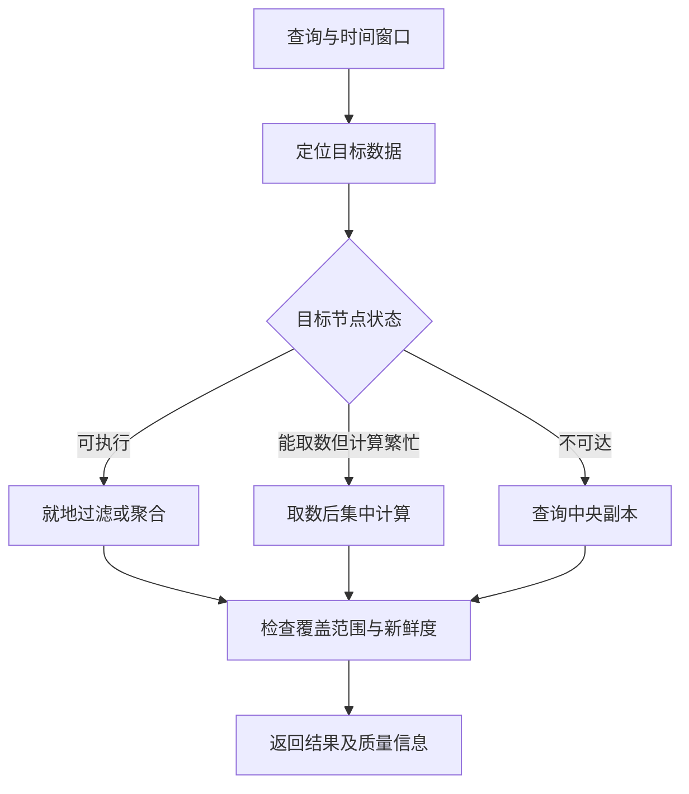

这篇论文最值得讨论的，不是“把日志、指标和追踪放进同一个系统”，而是一个责任分配问题：**谁承担日常分析的计算，谁承担事故期间的兜底？** 如果把这两笔账混在一起，既容易高估节省，也容易低估故障时的负载。

阅读对象为 Zhenyu Ren 等人的 *All Along the Watchtower: Achieving the Trinity of Observability in Cloud with DiTing*，发表于 OSDI 2026，印刷页 2501–2514。[会议原页](https://www.usenix.org/conference/osdi26/presentation/ren)提供作者与正式出处；[官方 PDF](https://www.usenix.org/system/files/osdi26-ren.pdf)包含完整设计和实验。下文页码均为印刷页，PDF 物理页多一张封面，例如 p.2505 对应 PDF 第 6 页。核验日期：2026-10-11。

本文是问题导向的原创评析，不代替原文。论文事实在引用处标明；模型、故障推演与测试建议均为本文分析，未运行作者系统。

## 1. 先用最少的事实建立设计坐标

DiTing 的中央—节点协作（CNC）优先在产生日志、指标和追踪的节点上，利用空闲资源执行查询；AZ 层承担持久化与回退。co-Log 提供统一布局，位置元数据帮助下推。节点不可达时转中央执行，节点仍可响应但计算繁忙时则可以只取数据、把计算移走。[§4.1–4.3，pp.2505–2507](https://www.usenix.org/system/files/osdi26-ren.pdf#page=6)

这几个事实可以拆成三个不同的问题：

- **数据能不能一起解释？** 需要公共时间、实体身份和关联方式；一个共同格式本身不能证明不同信号具有相同语义。
- **计算应在哪里发生？** 需要知道目标数据的位置，也需要判断那个位置此刻有没有资源。
- **原位置失效后还能回答什么？** 取决于另一份数据的新鲜度及兜底容量，不能只看请求有没有返回。

把这三层分开后，读者就不必把“统一可观测性”理解成一种万能数据库。真正应追问的是：哪些查询可以利用局部性，哪些语义必须由系统额外提供？

## 2. 下推的收益来自缩小工作，而不是“分布式”三个字

设一次诊断需要在时间窗口内读取数据量 D，本地过滤与聚合后只需返回 R。本文的简化模型是：中央扫描路径大致搬运 D，而下推路径搬运 R 加必要的控制与元数据。如果 R 远小于 D，下推可能节省网络；如果只是原样导出，R 接近 D，网络收益就很有限。

还要加上一个容易遗漏的条件：**路由要足够准确**。如果为找一块虚拟盘的数据向大量无关节点发请求，即使每次只返回“没有”，控制流、排队和尾延迟仍可能压垮收益。因此，对象身份到物理位置的映射，应当与查询算子一起评估，而不只是作为管理后台信息。

对现有系统做迁移时，我会先测三项，而不是先重写存储格式：

1. 有多少查询可以在读数据前缩小节点集合？
2. 过滤后返回的数据与扫描量之比是多少？
3. 实体迁移或元数据滞后时，漏查、重复和扩散扫描分别如何被发现？

这里的第三项尤其重要。位置映射通常不是静态真理。针对迁移中的实体，一个值得验证的策略是携带映射版本，并允许有界地查旧、新两处；但这只是本文提出的测试方向，**不是对 DiTing 已实现该协议的描述**。

### 图 1：本文的查询责任模型



图注：这是本文用于讨论责任边界的模型，不是论文架构图的复刻，也不代表其全部状态机。尤其“检查覆盖范围与新鲜度”是本文建议统一考虑的结果接口，不意味着论文提供了完全相同的字段。

## 3. 回退成功，不等于诊断信息完整

论文的节点数据会周期上传；节点与中央执行可能因新鲜度而不同。其复制讨论采用单写者、固定节点 leader 的简化设计，不提供强 ACID。[§4.4–4.5，p.2508](https://www.usenix.org/system/files/osdi26-ren.pdf#page=9)

据此可以推演一个必须做的实验：某节点在产生错误日志后、下一次上传前突然离线。此时中央路径仍可能返回正常响应，但最靠近故障的那段记录未必在副本中。这个例子说明，**服务可用性、数据持久性、诊断完整性是三个不同指标**。不能用“有副本”替代对最后一段数据命运的说明。

一个更有用的结果契约可以包含：查询覆盖到哪些节点、数据时间水位、缺失分区、是否发生回退。对跨信号关联，还应区分“查不到对应日志”和“日志所在窗口尚未覆盖”。否则一条看似精确的空连接结果，可能被误读为没有故障。

下面是本文建议的诊断端消费方式，不是论文伪代码，也不是可直接部署的实现：

```text
result = run_query(scope, time_window)
if result.coverage_is_incomplete:
    show_partial_result_with_missing_scope(result)
elif result.data_watermark < time_window.end:
    show_result_with_freshness_warning(result)
else:
    show_result(result)
```

其价值不在这几个分支，而在让结果质量成为调用者可见的信息。对于告警或自动处置，缺失数据应当触发怎样的保守行为，需要另订业务契约。

## 4. 低成本的前提：平时可借，出事可退

论文的成本对比针对匿名内部系统；所报最高 65 倍 CapEx 差异对应 Solution A，并且节点借用资源不计入其 Type II 成本。[§5.3，p.2511](https://www.usenix.org/system/files/osdi26-ren.pdf#page=12) 这不是通用云账单折扣，也不是 ClickHouse 的公开价格比较。

对迁移决策，更有解释力的是把成本分成三笔：

- **新增支出**：为了观测专门购买的计算与存储。
- **机会成本**：观测占用的内存、CPU、磁盘和网络，原本能否服务其他负载。
- **保障成本**：故障兜底容量、隔离与升级回滚、操作复杂度。

这三笔账可以同时成立：专用集群确实缩小，整体资源消耗却不一定按相同比例缩小；节点“空闲”也不意味着它在最坏时刻仍然空闲。把增量财务成本优化当成全系统资源效率证明，会把两个正确但不同的问题混为一谈。

可以用一个很小的容量模型看清风险。令正常请求量为 λ，每个回退请求的中央服务需求为 s，回退比例为 p，则中央查询需求约为 λps。这个式子只用于拆变量，不预测 DiTing 的实际吞吐。事故中，λ 和 p 可能同时上升，s 也可能因缓存失效而增加。只按平时平均回退量配机器，恰好会在最需要观测时失去余量。

因此，我会把验证重点放在**相关失败**，而不只是一批随机失联节点：同一机架失联、区域网络退化、共享元数据不可用、业务突发恰好伴随查询突发。还应测主动让渡资源后，业务尾延迟是否改善，以及观测系统是否明确进入降级状态。

## 5. 怎样读实验，才不会把数字变成产品承诺

最重要的不是多抄几个加速比，而是检查比较是否回答自己的问题。

原文微基准存在需要保留的口径差异：最短指标窗口的文字与图表不一致；图中 CK 与正文 centralized-only 的基线命名不统一；[引言 p.2502](https://www.usenix.org/system/files/osdi26-ren.pdf#page=3) 的单核 QPS 与 §5.1 图文也不同。因此本文不采用这些争议倍数作为结论。[§5.1，p.2509，Fig.9 与 Table 2](https://www.usenix.org/system/files/osdi26-ren.pdf#page=10)

一个较明确的实验锚点是：固定的 CPU 指标→trace→错误日志时间连接，三档规模耗时为 0.4 / 0.6 / 1.1 秒；这不能代表任意跨信号查询，更不是根因判断准确率。[Fig.9(g) 与设置，pp.2509–2510](https://www.usenix.org/system/files/osdi26-ren.pdf#page=10)

我对复现实验的最低要求如下。它们是本文建议，不是论文缺失功能的判定：

| 要回答的问题 | 应固定或披露的条件 | 不能直接推出什么 |
| --- | --- | --- |
| 是布局更好，还是缓存更热？ | 缓存容量、冷热比例、数据保留范围 | 热数据延迟不能代表历史全扫 |
| 是预聚合节省计算，还是执行器更快？ | 返回精度、聚合粒度与计算发生的位置 | 不同分辨率结果不能直接做同义比较 |
| 下推是否真正省总资源？ | 节点和中央的合计 CPU、内存、网络 | 中央 CPU 下降不等于整体 CPU 同幅下降 |
| 回退能否支持事故诊断？ | 故障相关性、请求并发、数据水位 | 请求成功不等于故障窗口完整 |
| 成本能否迁移到自己的环境？ | 折旧、借用资源计价、隔离和运维成本 | 单一内部财务模型不能当报价单 |

此外，应把并发数、吞吐与延迟放在一起看。改变并发会改变排队，改变扫描列数会改变工作量，预聚合又可能改变输出语义。只挑一个吞吐点，而隐藏这些条件，很难指导采购或改造。

## 6. 值得带走的设计判断

**最可迁移的部分，是让查询计划知道数据在哪里、资源此刻能否使用，以及失败后结果会损失什么。** 是否需要自定义格式，反而应该放到测量之后决定。

如果当前痛点是诊断要跨工具手工拼接，先统一实体与时间语义、提供关联入口，可能比立即合并全部存储更划算。如果主要成本来自搬运大量本可在源头压缩的查询结果，才值得优先做位置感知的下推。若业务节点缺乏安全余量，则必须先解决资源隔离，不能把“借用空闲”当成部署前提已经成立。

最后，观测系统依赖被观测系统，本身就是风险。需要提前决定：哪些极小但关键的健康信号应通过独立路径保留，哪些诊断可以接受延迟，哪些自动处置必须在数据不完整时停止。DiTing 提供了讨论这些边界的具体切口；它没有消除我们为自己的故障模型、数据契约和成本口径作出选择的责任。

继续阅读：[专题入口](https://bryantchang1992.github.io/ai_memory_chang_ai_team/library/observability/) · [官方完整论文](https://www.usenix.org/system/files/osdi26-ren.pdf)。本页不提供全文翻译或原文副本。
